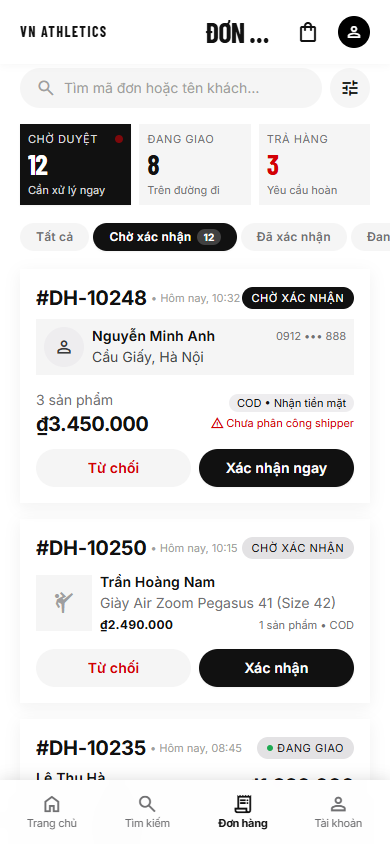
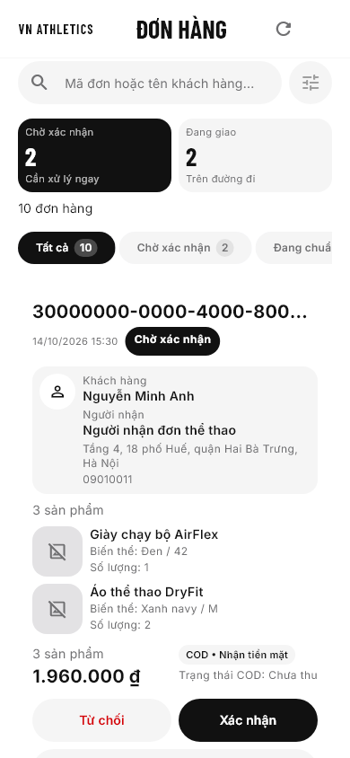

# MH08 — USER APPROVED

Người dùng chốt MH08 và yêu cầu commit/push ngày19/10/2026; kết quả04B3 ghi bên dưới.
Các mục01–04B2 là lịch sử; trạng thái NOT YET APPROVED trong đó không phải approval hiện tại.

## Screenshot references

| HTML Chromium390×844 mới04A | Flutter widget render390×844 mới04A |
| --- | --- |
|  |  |

- [HTML full page](artifacts/html_390_full.png), [manifest](artifacts/html_render_manifest.json).
- [Flutter legacy manifest](../../visual_refinement_artifacts/render_manifest.json).
- [Android03B runtime smoke](artifacts/android_03b_data.png): ảnh từ emulator, không cùng viewport HTML; không dùng để kết luận fidelity.
- Không xem hai bộ dữ liệu khác nhau là bằng chứng pixel-perfect; chưa đo image diff.

## Visual Difference Matrix — kế hoạch lịch sử01; actual04A ở VISUAL_AUDIT

| Vùng | Audit Flutter hiện có | Plan / intentional deviation | Status |
| --- | --- | --- | --- |
| Header | Shared brand/title/refresh | MH08 riêng; giữ refresh, không cart/call giả | Planned |
| Heading | Thêm title body lớn | Giảm vùng đầu, hierarchy theo HTML | Planned |
| Search | Pill lớn, chưa có tune affordance | Pill compact; filter chỉ mở lựa chọn status đã hỗ trợ | Planned |
| KPI |2 panel cao, thiếu subcaption | Compact2 panels; bỏ Returns chưa có contract | Planned |
| Chips | Count avatar trước text | Chip pill + count gọn theo server; đủ enum | Planned |
| Card | Generic cao, UUID wrap | Compact shell/buyer/payment/actions, full UUID vẫn accessible | Planned |
| Buyer | Text rời | Cloud panel/name/address snapshot | Planned |
| COD | Full-width generic block | Compact total/COD; giữ null summary unavailable | Planned |
| Warnings | Generic projection | Icon/text từ server, không pending-unassigned giả | Planned |
| Buttons | Outlined Wrap | Reject soft/red, confirm black, ≥48 hit target | Planned |
| Radius | Generic shared card |16 intent; HTML rounded-DEFAULT render ra0 | Planned |
| HTML lỗi | Title bị cắt,2 bottom bars chồng | Không copy lỗi DOM hoặc route không hỗ trợ | Intentional |

## Android checklist — lịch sử01 chưa chạy; kết quả03B ghi bên dưới

| # | Thao tác / expected | Status |
| --- | --- | --- |
|1|Mở MH08 từ Preview; role manager, không error screen|NOT RUN|
|2|Search full UUID/tên tài khoản khách; kết quả đúng fixture contract|NOT RUN|
|3|Clear search; filter còn phù hợp, cursor về head|NOT RUN|
|4|Đổi status chips, scroll ngang, không Returns status giả|NOT RUN|
|5|KPI authoritative, không phụ thuộc số rows đã tải|NOT RUN|
|6|Cuộn nhiều cards/name dài; không overflow|NOT RUN|
|7|Load next page/retry; không duplicate hoặc mất rows|NOT RUN|
|8|Confirm dialog; submit hiện backend unavailable|NOT RUN|
|9|Reject dialog; đúng order, không fake success|NOT RUN|
|10|Reason blank bị chặn, lỗi cùng phiên không mất input|NOT RUN|
|11|Mở MH09 bằng UUID qua Preview callback|NOT RUN|
|12|Back MH08; query giữ đúng, counts/list được refresh|NOT RUN|
|13|Chuyển loading/empty/error/stale/expired, action gate đúng|NOT RUN|
|14|Keyboard + text scale2 + SafeArea; không che actions|NOT RUN|
|15|Session unavailable/unauthorized; private UI che ngay|NOT RUN|

## Responsive, interactions, tests và LOC

- Responsive04A:15cases đều chạy; layout checks PASS, toàn case FAIL K1 keyboard; xem [TEST_PLAN](TEST_PLAN.md).
- MH08- 03A automated integration:70 focused PASS,246 full suite PASS; Android/manual NOT RUN.
- MH08- 03A owned LOC gate PASS: page288/main test122; shared legacy giữ nguyên, xem [HANDOFF](HANDOFF.md).
- File mới/sửa, review và kết quả03A: [HANDOFF](HANDOFF.md).
- Analyze03A không có issue; không build/chạy Android hoặc claim visual fidelity trong task này.

## Known limitations

- Entrypoint03B mở shell chung, default MH07; legacy harness/data MH07 được giữ nguyên.
- Harness đa màn legacy không được main import; manager fixtures03B riêng có10 đơn/page size3.
- Read repository production chưa nối; confirm/reject local validation rồi unavailable.
- Server count/search/warnings chưa được runtime backend verify.
- Return-refresh03B dùng exact canonical query, recheck mounted/current scope/epoch; không tích hợp backend.
- Reference dùng CDN. Sandbox DNS fail; render thành công khi được phép network, source HTML không sửa.

## Manual run command sau MH08-03B

```powershell
flutter devices
$env:GRADLE_OPTS='-Dorg.gradle.project.kotlin.incremental=false -Dorg.gradle.project.kotlin.compiler.execution.strategy=in-process'
flutter run --no-pub -d emulator-5554 -t tool/ui_preview/main.dart
```

Device ID phải lấy từ `flutter devices`. Mặc định MH07; menu **Chọn màn hình → MH08**, menu **Chọn trạng thái** chọn scenario.
GRADLE_OPTS chỉ áp dụng process hiện tại, dùng workaround incremental/Kotlin khi cần; không sửa project Gradle.

## Feedback / approval

- Feedback người dùng cho MH08: chưa có trong task này.
- MH08-01/02/03A: người dùng đã duyệt; MH08-03B không tự cấp visual approval.
- UI MH08: **NOT YET APPROVED**. Không chuyển MH09/MH17/Phase3 và không commit/push.

## MH08-03B — Android Preview runtime

Status: **MH08-03B — PREVIEW INTEGRATED, READY FOR VISUAL VERIFICATION**; visual approval **NOT YET APPROVED**.
Pixel5 emulator `emulator-5554`, build/install/launch debug bằng entrypoint hiện hữu; Gradle workaround chỉ process-local.
ADB thao tác trên app thật và UI hierarchy; không dùng build APK đơn thuần làm bằng chứng runtime.

| Kiểm tra03B | Kết quả |
| --- | --- |
| Default MH07 và chuyển MH07→MH08→MH07 | PASS; quay lại customer dataset16 orders |
| Manager data/KPI | PASS;10 orders, pending2/shipping2 trước paging |
| Full UUID/search clear/status chips | PASS; UUID1 row, counts theo query; clear/status giữ contract |
| Scroll/paging | PASS; quan sát orders thứ5–6 từ page2; counts vẫn authoritative |
| Next-page error/retry | PASS; giữ rows khi lỗi, retry hiện card trang tiếp |
| Confirm/reject | PASS; mở/đóng, confirm unavailable, reject blank reason blocked |
| MH08→MH09→MH08 | PASS; UUID card page2 được truyền nguyên, Back quay lại list |
| empty/error/stale/expired | PASS; no-data/retry/stale notice; expiry không còn buyer/order |
| unauthorized/session unavailable | PASS; denied/loading-session UI, không private fallback |
| Framework/runtime exceptions | Không thấy uncaught Flutter/AndroidRuntime error trong logcat smoke |
| Modal expiry/delayed response races | Widget tests PASS; không claim Android manual race test |
| Full responsive/TalkBack/fidelity | NOT RUN; dành MH08-04 |

Verification:19 focused Preview tests PASS,265 full tests PASS, Analyze/format/diff/LOC PASS.
145 protected source files giữ nguyên hash đầu03B, gồm lib/MH07/03A/shared/fixtures/old Preview.
New/sửa file và physical LOC: [HANDOFF](HANDOFF.md); owned LOC gate PASS, không exception mới.
MH09 `onAccepted` hiện hữu invalidates list khi detail được đọc; pop03B còn yêu cầu1 canonical refresh theo query hiện tại.
Không có mutation production; manager controls unavailable, không optimistic status hay fake success.
Screenshot runtime chỉ là smoke evidence; chưa render Flutter cùng viewport HTML hoặc đo visual differences.
Tiếp theo cần người dùng cho phép MH08-04; không thực hiện visual correction trong03B.

## MH08-04A — audit hiện tại

**MH08-04A — VISUAL AUDIT COMPLETE, READY FOR TARGETED REFINEMENT**. UI **NOT YET APPROVED**.
[VISUAL_AUDIT](VISUAL_AUDIT.md) là region comparison/defect matrix hiện tại; bảng Planned bên trên là lịch sử01.
[Side by side](artifacts/visual_04a/comparison_390.png), [overlay](artifacts/visual_04a/overlay_390.png), [matrix report](artifacts/visual_04a/mh08_04a_matrix_report.json).

- P0: chưa phát hiện trong checks/runtime đã chạy.
- P1/K1: KPI/total không ẩn khi keyboard;15/15 cases fail cùng nguyên nhân consume viewInsets tại Scaffold.
- P2: feed bắt đầu y318 thay269; card580h thay234h, phần lớn do data thật. Có thể tune duplicate quantity/gaps.
- Header64h/x20/w350/font chính đúng;2 KPI/UUID/placeholders/status labels/no fake nav là intentional deviations.
- 89 existing regression tests PASS, Analyze/format/diff/LOC PASS;2 new audit tests FAIL K1, giữ assertions.
- 265 full-suite là kết quả03B, không rerun full04A; không gọi current full suite PASS.
- Android04A build/install/launch + search/clear/chip scroll/paging/dialog/blank reason/unavailable/MH09/back/scenarios PASS smoke.
- Expired/unauthorized/session unavailable không private nodes; logcat không uncaught errors trong smoke.
- IME toolbar nổi: opening/closing đã kiểm tra; docked keyboard runtime NOT VERIFIED, widget inset300 cóK1.
- TalkBack bound tạm, labels/focus sample kiểm tra; full audio/swipe focus order NOT VERIFIED; cấu hình đã restore.
- Screenshot widget không chứng minh Android runtime; raw overlay/data khác không chứng minh pixel-perfect.

Đã dừng04A. Đề xuất04B: sửa keyboard tại MH08 layout/controls trước, rerunmatrix; sau đó tuneP2 trong componentsMH08.
Không sửa production appearance/shared/MH07/MH09/MH17/backend ở lượt audit này.

## MH08-04B1 — keyboard regression closure
**MH08-04B1 — KEYBOARD REGRESSION FIXED, READY FOR VISUAL DENSITY REFINEMENT**.
K1 root cause đã xác nhận bằng SDK Scaffold và red baseline2tests/15cases trước sửa.
`mh08_page_layout.dart` capture visibility trước Scaffold, truyền derived bool qua Mh08KeyboardVisibility.
`mh08_list_controls.dart` dùng signal để hide/restore KPI+total; không restore raw MediaQuery/padding, Scaffold resize1lần.
Giữ SafeArea, search/controller/chips/feed composition, session/capability guards và business providers nguyên trạng.
Original2 audit tests không đổi, rerun15/15 PASS; mới2 lifecycle tests PASS (15 open-close-reopen + paging).
Query/search/status/counts được giữ; không tăng manager read hoặc mất loaded IDs khi keyboard đổi inset.
Fresh full suite269 PASS (gồm89 affected +2 audit +2 lifecycle), Analyze/format/diff/LOC PASS.
Production LOC: layout74/180, controls65/180; test274/400.290 baseline files ngoài2file sửa giữ nguyên SHA-256.
Không ghi ảnh/report mới vào04A: comparison/failures04A ở trên là evidence lịch sử, không phải trạng thái lỗi hiện tại.
Android Pixel5/API35: build/install/launch K1 APK; normal counts và đổi MH07/MH08 hoạt động, không uncaught logcat error.
Gboard dùng toolbar/cửa sổ nổi (IME frame chỉ66physicalpx); docked inset runtime **NOT VERIFIED**.
Không dùng keyboard nổi hay APK build đơn thuần để claim docked runtime PASS; widget inset đã PASS đủ15cases.
P2 density/quantity/gaps giữ nguyên. DỪNG04B1;04B2 cần người dùng cho phép. UI **NOT YET APPROVED**.

## MH08-04B2 — current review candidate

**MH08-04B2 — VISUAL DENSITY REFINED, READY FOR FINAL MANUAL REVIEW**. UI **NOT YET APPROVED**.

- [HTML / trước / sau390](artifacts/visual_04b2/comparison_390.png), [top hiện tại](artifacts/visual_04b2/mh08_04b2_refined_390x844_s1_top.png).
- [First card](artifacts/visual_04b2/mh08_04b2_refined_390x844_s1_firstcard.png), [actions](artifacts/visual_04b2/mh08_04b2_refined_390x844_s1_actions_bottomcard.png).
- [Multi-product](artifacts/visual_04b2/mh08_04b2_refined_390x844_s1_multiproduct.png), [long buyer](artifacts/visual_04b2/mh08_04b2_refined_390x844_s1_longbuyer_address.png), [warning](artifacts/visual_04b2/mh08_04b2_refined_390x844_s1_warning.png).
- [320 scale2](artifacts/visual_04b2/mh08_04b2_refined_320x844_s2_top.png), [keyboard inset](artifacts/visual_04b2/mh08_04b2_refined_390x844_s1_keyboard.png), [landscape](artifacts/visual_04b2/mh08_04b2_refined_844x390_s1_top.png).
- Ảnh là **Flutter widget render**, OS keyboard không được vẽ; toolbar Preview ẩn để so logical viewport; không chứng minh runtime Android.
- Card đầu cùng fixtures:580→476px, y318→277, actions633/details689 (48h); buyer142→106, items148→104.
- Thông tin đầy đủ, quantity không lặp; total canonical đi cùng strip trạng thái; font KPI Barlow28, search giữ48.
- Original K1 audit2 PASS/15cases; lifecycle2 PASS; affected100 PASS; full276 PASS; Analyze/format/diff/LOC PASS.
- 8 existing code/test deltas được phép;285/293 baseline files khác giữ SHA-256, gồm MH07/page/controller/fixtures/04A evidence.
- Độc lập review không finding; chi tiết LOC/source ở [HANDOFF](HANDOFF.md), [audit](VISUAL_AUDIT.md).
- Hai baseline320 filename captures cấu hình sai DPR đã đánh dấu excluded trong report; chỉ refined320 là bằng chứng320/scale2.
- Android runtime lượt04B2 **NOT RUN**, chủ đích dành04B3; docked IME và full TalkBack vẫn cần kiểm tra thật.
- 04B3 cần review với toolbar DEMO/system bars, long names/warnings,48px targets, search/clear/chips/pages/dialogs/MH09/back/privacy.
- Dùng lệnh Preview hiện có ở tài liệu này, default MH07 rồi chọn MH08; không có backend mutation success.
- Chưa có feedback/approval người dùng cho UI sau04B2. Đã dừng, không tự chạy04B3/MH09/Phase3/commit/push.

## MH08-04B3 — current Android acceptance candidate

**MH08 — USER APPROVED,19/10/2026**. Người dùng xác nhận chốt MH08 và yêu cầu commit/push; runtime04B3 được ghi nhận16/10.
[ANDROID_ACCEPTANCE](ANDROID_ACCEPTANCE.md) chứa case matrix, limitations và checklist để người dùng duyệt.
[HTML / widget04B2 / Android](artifacts/visual_04b3/comparison_html_widget_android.png), [Android review start](artifacts/visual_04b3/android_user_review_start.png).
- Pixel_5/API35: APK mới build/install/launch, default MH07; switch/search/filter/paging10 UUID/cards/dialogs/MH09/back/scenarios PASS.
- Native actions132physical/2.75=48logical; details cần scroll do DEMO/system bars; không claim cùng viewport HTML390×844.
- VM read-only object inspection: pop canonical +1head (55→56), cursor3 không đổi;3 cursor unique cho4pages.
- K1 floating/handwriting open-close-reopen restore PASS; **DOCKED ANDROID IME — NOT VERIFIED**, frame chỉ66physicalpx.
- Native landscape/font1.5 smoke PASS; original widget matrix15/15 PASS, không thay thế full Android responsive matrix.
- TalkBack bound, Tab/swipe đã thử; **full focus order/audio NOT VERIFIED**. Font/rotation/accessibility/Gboard settings đã restore baseline.
- Fresh100 affected/276 full-suite PASS, Analyze/diff/LOC/hash PASS;328 protected files/MH07/04A/04B2 nguyên SHA-256, production0changes.
- ADB nhập UUID nhanh có lượt thiếu6 ký tự; chỉ lượt đã kiểm tra đủ36 mới dùng làm evidence. User cần tự typing/paste; xem limitations trong acceptance.
- Harness attempts/VM probes thất bại được giữ và loại khỏi kết luận PASS; không ghi đè evidence cũ, không fake mutation success.
- Chỉ3 runtime utility scripts mới, không Dart changes để format; helper LOC141/123/150, docs≤200/HANDOFF≤100.
- User approval19/10 cho phép commit/push milestone MH08; chưa bắt đầu MH09/MH17/Phase3. Các NOT VERIFIED phía trên giữ nguyên.
