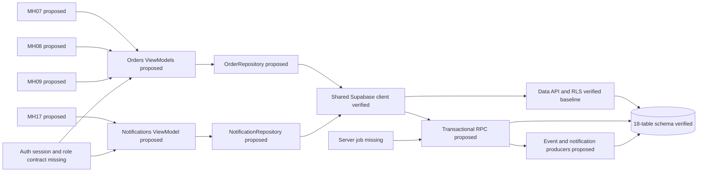
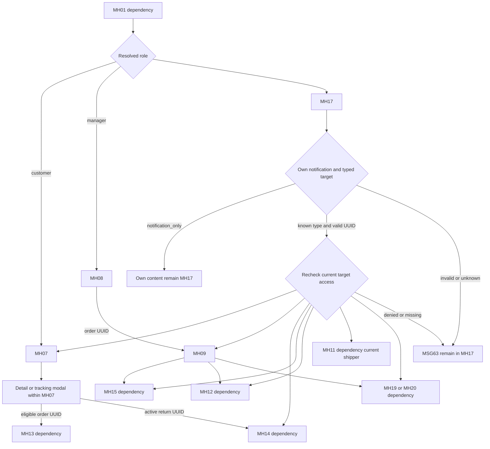
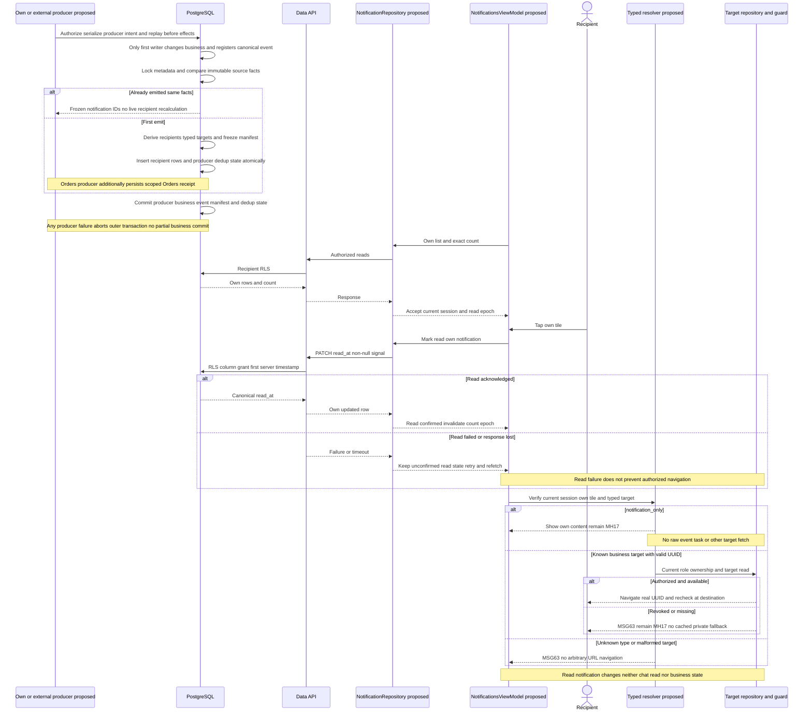
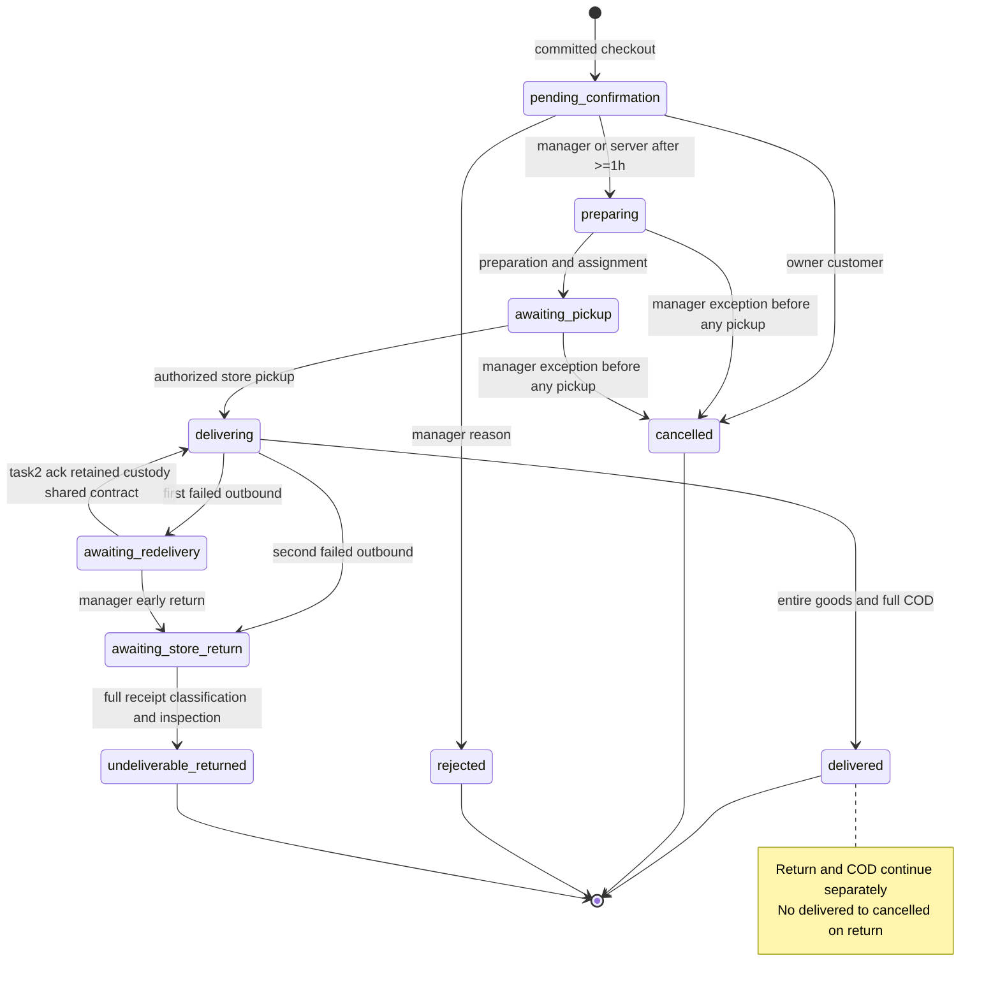
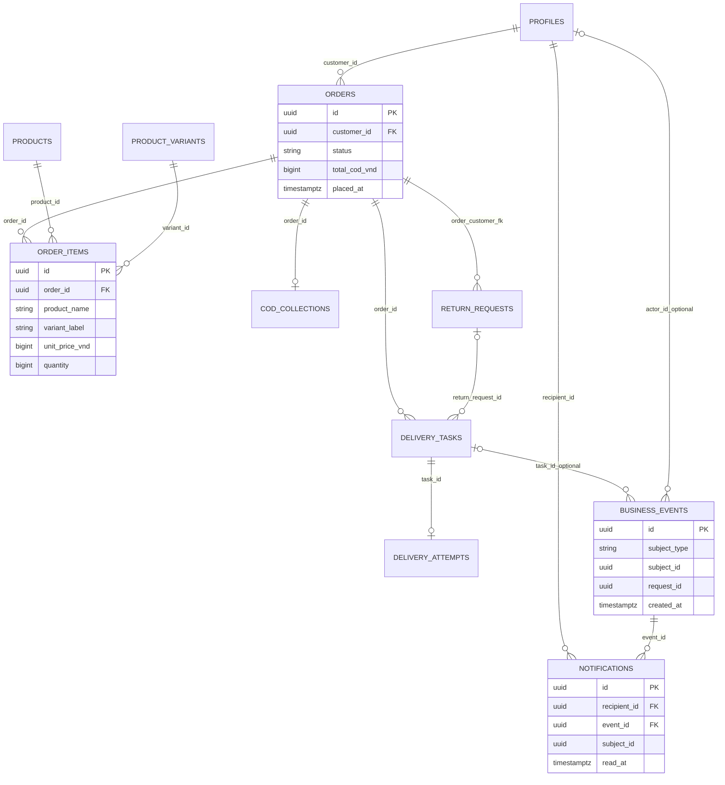

# Technical Specification & Implementation Blueprint — MH07, MH08, MH09, MH17

## 1. Thông tin tài liệu và phạm vi

| Thuộc tính | Giá trị |
|---|---|
| Dự án | PRM393, Group 1, Online Sportswear and Equipment Shopping Mobile Application |
| Người phụ trách nghiệp vụ | Lê Gia Bảo: orders và notifications |
| Phiên bản tài liệu | 1.2 — Technical design finalization, ngày 08/10/2026, múi giờ trình bày Asia/Ho_Chi_Minh |
| Snapshot repository | `77b3623e863857237816752151067acae07f0d3d` |
| Phạm vi | MH07 My Orders; MH08 Manager Order List; MH09 Manager Order Details; MH17 Notifications |
| Loại công việc thực hiện | Phân tích và tài liệu hóa; không triển khai Flutter, SQL, RPC hay thay cấu hình |
| Mức sẵn sàng | READY FOR PARTIAL IMPLEMENTATION từng màn; external runtime gates ở Implementation_Readiness_v1.2.md |
| Người đọc | Nhóm phát triển, reviewer và AI coding agent nhận bàn giao |

Tài liệu dùng cùng ba phụ lục, không đọc phần blueprint tách khỏi các điều kiện chặn:

- [Data dictionary và API contracts](technical_specification_mh07_mh08_mh09_mh17_data_api.md).
- [Test plan và requirement-to-test traceability](technical_specification_mh07_mh08_mh09_mh17_tests.md).
- [Source evidence, inventory và conflict register](technical_specification_mh07_mh08_mh09_mh17_evidence.md).

Quy ước bằng chứng bắt buộc:

| Nhãn | Ý nghĩa |
|---|---|
| `VERIFIED IN CODEBASE` | Đã đọc file/symbol trong snapshot; không có nghĩa đã chạy app hay áp dụng cloud |
| `SPECIFIED IN GROUP DOC` | Có trong file `Nhóm 1_Docs.docx`, dẫn theo section/BR/CR/MSG/NFR |
| `PROPOSED IMPLEMENTATION` | Thiết kế chưa triển khai; phân biệt authority dưới đây, không existing API/table |
| `OWNER DECIDED` | Owner ủy quyền chốt Orders/Notifications revision1.2; không business rule mới |
| `SHARED CONTRACT` | Exact handoff đề nghị owner khác; NOT ACCEPTED/NOT IMPLEMENTED |
| `EXTERNAL DEPENDENCY` | Implementation owner khác, không thay thế trong phần việc này |
| `REQUIRES BUSINESS DECISION` | Quy tắc nhóm chưa đủ; baseline disable nhánh liên quan |
| `NOT VERIFIED` | Chưa có nguồn chứng minh hoặc chưa xác minh thực thi |

Các ảnh UI là bằng chứng trực quan về bố cục, không phải bằng chứng phê duyệt policy. Revision1.2 các thiết kế Orders/Notifications được owner ủy quyền chốt trong FinalDecisions; các nhãn PROPOSED trong blueprint nghĩa implementation chưa có, không còn own technical approval gate. SHARED CONTRACT chưa accepted cần owner ngoài xác nhận; business open questions không tự đổi policy/schema. Các giá trị minh họa JSON không phải seed/demo đã tồn tại.

## 2. Tổng quan kỹ thuật

`VERIFIED IN CODEBASE`: dự án đã khởi tạo Flutter Android/Web, dependency trực tiếp `flutter_riverpod 3.4.3`, `go_router 18.0.2`, `supabase_flutter 2.18.0`. `lib/main.dart::main` khởi tạo Supabase và `ProviderScope`; `supabaseClientProvider` cung cấp một client; `SportsStoreApp` dùng `MaterialApp.router`. Router chỉ có `/`; theme chỉ có Material 3 với seed xanh. Chưa có Auth ViewModel, guard, model/repository nghiệp vụ, bốn trang hay realtime subscription. Feature-first MVVM là cấu trúc đã dựng và kiến trúc được nhóm quy định; chưa có luồng MVVM nghiệp vụ hoàn chỉnh để tái sử dụng.

`VERIFIED IN CODEBASE`: ba migration kết hợp tạo schema cuối gồm 18 bảng và RLS. Khách/manager đọc đơn theo quyền; client không được trực tiếp sửa trạng thái đơn, kho, giao hàng hay COD. Notifications có dữ liệu người nhận, FK sự kiện, khóa chống trùng và trigger giữ mốc đọc đầu tiên do server ghi. Không có RPC nghiệp vụ hoặc Cron xác nhận đơn trong migration.

`SPECIFIED IN GROUP DOC`: đơn COD giao tại Hà Nội, phí 30.000 VND, snapshot bất biến; xác nhận thủ công hoặc tự động sau ít nhất một giờ; khách chỉ hủy pending; manager hủy ngoại lệ sau xác nhận trước pickup; tối đa hai lần giao đi; đơn, nhiệm vụ, COD và trả hàng là bốn lifecycle độc lập; thông báo chỉ in-app.

Ba gaps implementation/design authority đã được phân loại revision1.2:

1. `orders.id` là UUID, chưa có mã `DH-*`; `order_items` chưa có ảnh snapshot. Không được tạo mã hoặc ảnh lịch sử bằng dữ liệu hardcoded.
2. Policy `tasks_read` và `business_events_read` không cho customer đọc task/historical events, dù `docs/database.md` mô tả khách xem trạng thái nhiệm vụ. MH07 cần projection an toàn thay vì mở toàn bộ task/audit cho khách.
3. Các transition RPC, cơ chế idempotency có lưu kết quả, event classification và job tự xác nhận chưa có. Unique constraint đơn lẻ không hoàn thành các workflow này.

## 3. Phân tích nguồn đầu vào và bằng chứng

Đã đọc toàn bộ nội dung văn bản của DOCX, sáu activity diagrams, context diagram, architecture/package diagrams và ba ảnh UI đính kèm. Dẫn nguồn section chính xác thay vì dùng số trang chưa kiểm chứng: TOC của Word có số trang cache, không xác nhận phân trang render hiện tại. Trường template ở bìa và phần database/test vẫn chưa điền. OR-09 dẫn tới Business Report v3.0 ngày 29/09/2026; bản báo cáo riêng và bảng đầy đủ NT01–NT30 không có trong input.

| Nguồn | Phần dùng trực tiếp | Kết luận |
|---|---|---|
| DOCX I.4.1–4.2 | Scope/exclusion | Không vouchers, loyalty, profile screens, GPS tracking, 3PL, push/SMS/email |
| DOCX II.1.2.1–1.2.3 | Đặt/xác nhận, hủy, giao thất bại | Pending → Preparing; hủy có kiểm tra pickup; cảnh báo mỗi failure distinct |
| DOCX II.1.2.4–1.2.6 | COD, pickup trả, inspection/refund | Các module bên ngoài cung cấp trạng thái/event, không gộp lifecycle |
| DOCX II.3.1–3.3 | BR-COM, CR, messages | Nguồn rules/validation/action feedback |
| DOCX II.2 NFR, II.3.4 | Targets và integration | NFR targets được tài liệu gọi là proposed acceptance criteria |
| SQL + `docs/` | Schema cuối, grant/policy, contracts | API đọc một phần đã được cấp quyền; transition chưa có |
| UI07/UI08/UI09 | Card, filter, summary, timeline, action | Bố cục tham khảo; mock status/count/brand/date không phải dữ liệu thật |

Các tham chiếu file/symbol và từng conflict nằm ở phụ lục evidence. Các link tài liệu chính thức Supabase/Riverpod trong phụ lục được kiểm tra ngày 08/10/2026; chúng giải thích cơ chế SDK, không xác nhận RPC riêng của dự án đã tồn tại.

## 4. Đánh giá codebase hiện có

| Hạng mục | Audit thực tế | Trạng thái |
|---|---|---|
| SDK | `pubspec.yaml::environment.sdk ^3.13.2`; lock yêu cầu Dart >=3.13.2 <4, Flutter >=3.47.0; README ghi Flutter 3.47.2 | Constraints `VERIFIED IN CODEBASE`; SDK đang chạy `NOT VERIFIED` |
| Tổ chức | `lib/app`, `core`, `shared`, 11 `features`; domain/data/presentation cho từng feature | Khung MVVM đã dựng |
| State/DI | Riverpod `ProviderScope`, client/router `Provider` | Nền đã có; ViewModels missing |
| Routing | `appRouterProvider` chỉ route `/` | Partially implemented; cần guard/role routes |
| Authentication | `Supabase.initialize`, cấu hình client-safe | SDK sẵn; login/logout/role loading/cache reset missing |
| Serialization | Chỉ `SupabaseConfig`, JSON trong script kiểm tra kết nối | Domain/DTO nghiệp vụ missing |
| Session/local storage | App dùng mặc định SDK, không truyền custom local storage; lock có shared_preferences transitive | Cơ chế bảo vệ token trên device `NOT VERIFIED`; NFR-05 là dependency Auth |
| UI | `AppTheme.light`: Material 3, `Colors.blue`; chưa custom typography/spacing | Không có bộ widget chung hay font VN ATHLETICS |
| Realtime | Local config bật dịch vụ; không migration publication hoặc subscription app | Freshness chưa triển khai; cloud configuration `NOT VERIFIED` |
| Backend | Supabase config + migrations + security SQL tests | Baseline schema/access có; business RPC missing |
| Mock/demo | Chỉ fixture SQL test, kết thúc ROLLBACK; ảnh UI có sample data | Không có repository demo dùng được |
| Platform | Android/Web scaffolding; chưa iOS; minSdk nhận từ Flutter, không chốt OS trong tài liệu | Mobile release compatibility `NOT VERIFIED` |

Không chạy build/test/database trong công việc tài liệu này. `docs/database.md` và `docs/supabase_setup.md` có ghi nhận kiểm tra lịch sử ngày 06/10/2026; tài liệu này không xác minh lại ghi nhận đó hoặc hiện trạng cloud, không dùng chúng làm evidence acceptance. Existing inventory đầy đủ và required changes nằm ở phụ lục evidence §2.

## 5. Truy vết yêu cầu và quy tắc nghiệp vụ

### 5.1 Business Rules Traceability Matrix

Tất cả BR dưới đây là `SPECIFIED IN GROUP DOC`, II.3.1; mức thực thi hiện tại khác với mức quy định.

| Rule | Nội dung tác động trực tiếp | MH | Thiết kế/operation | Backend hiện có |
|---|---|---|---|---|
| BR-COM-02,03 | Ownership/role; riêng tư evidence/bank | 07/08/09/17 | RLS + guard + recheck destination | Policy baseline có; app guard missing |
| BR-COM-06,07 | COD; 30.000; nguyên VND | 07/08/09 | Đọc totals snapshot, không discount | CHECK/generated có; RPC placement missing |
| BR-COM-09 | Snapshot; không sửa đơn đã tạo | 07/08/09 | OrderItem snapshot, recipient snapshot | Cột có; ảnh/mã hiển thị thiếu |
| BR-COM-10,11 | Confirm không reserve lại; release một lần; hỏng/mất riêng | 07/08/09 | confirm/reject/cancel transaction | Kho/ledger có; workflow missing |
| BR-COM-12 | Confirm/reject pending; reason; auto >=1 giờ, không auto shipper | 08/09/17 | Mutation + server job + events | RPC/job missing |
| BR-COM-13 | Customer cancel pending; manager exception trước pickup | 07/09/17 | Actor/current state/custody check | Writes bị chặn; RPC missing |
| BR-COM-14 | Cancel/reject không reconfirm; race chỉ một thắng | 07/08/09 | Row lock + precondition dưới lock | Chưa workflow |
| BR-COM-15 | Chuẩn bị + phân công mới awaiting_pickup; reassign trước pickup | 08/09 | Handoff với Deliveries | Tables/index có; RPC missing |
| BR-COM-16 | Delivered và thu đủ COD đồng thời | 07/08/09/17 | Đọc hai trạng thái; delivery contract | Constraint amount có; transaction missing |
| BR-COM-17 | Hai lần outbound toàn order; lần đầu retry/return; lần hai return | 08/09/17 | Attempt warning + ngoại lệ manager | CHECK/UNIQUE có; workflow missing |
| BR-COM-18 | Failure có reason/time/shipper/attempt; mỗi failure báo một lần; incident riêng | 08/09/17 | Timeline/event matrix | Fields có; creation missing |
| BR-COM-19 | Nhận/inspection mới restock; không refund COD chưa thu | 09/17 | Handoff receipt/inspection | Không tự cập nhật client |
| BR-COM-20–22 | COD độc lập; nhận đủ từng order; refund không offset | 07/09/17 | COD summary và link MH12 | Read/constraints có |
| BR-COM-23–25 | Return <=7 ngày tại submit; reasons/video/bank; một active; hàng thực nhận | 07/09/17 | Link MH13/MH14/MH15, eligibility preview | Active index có; server eligibility missing |
| BR-COM-26–30 | Pickup không bảo đảm refund; full refund; redelivery miễn phí | 09/17 | Hiển thị outcome riêng, điều hướng returns | Backend contract khác owner |
| BR-COM-31 | Bốn lifecycle riêng; delivered không thành cancelled vì return | 07/08/09/17 | Status model/projection tách | Enum riêng có |
| BR-COM-32 | Persist recipient/read; dedup event+recipient; recheck link | 17 | List/count/read/deep-link | Notification schema/policy/trigger có |
| BR-COM-34,35 | Chat text; không shipper; notification read != chat read | 09/17 | Link authorized conversation | Chat baseline có; destination app missing |
| BR-COM-36 | Retry cùng operation/event trả lại kết quả | Cả bốn | Persistent receipt, same request ID | Unique một phần; replay contract missing |

### 5.2 Role-Permission Matrix

| Tác vụ | Customer | Manager | Shipper | Enforcer |
|---|---|---|---|---|
| MH07 + đọc order/items | Của mình | Dùng MH08/09 | Không | `orders_read`, `order_items_read`, route guard |
| MH08/09 | Không | Đơn cửa hàng | Không | RLS + manager guard |
| Cancel thường | Own pending | Không dùng luồng customer | Không | RPC `PROPOSED` |
| Confirm/reject | Không | Pending; reject có reason | Không | RPC `PROPOSED` |
| Cancel ngoại lệ | Không | Đã confirm, chưa pickup, reason | Không | RPC cùng Deliveries `PROPOSED` |
| Dispatch/retry/early-return/receipt | Không | Theo precondition | Chỉ action riêng MH11 | Handoff API, không gọi VM khác |
| Đọc COD | Own order | Các order | Own obligations | `cod_read` |
| Reconcile COD | Không | Chuyển MH12 | Không được confirm | Owner COD RPC |
| Read notifications/mark read | Own | Own | Own | `notifications_read/update` |
| Tạo notifications/audit | Không | Không trực tiếp | Không trực tiếp | Transaction/server producer |
| Task raw | Không theo policy hiện tại | Có | Assigned current | `tasks_read` |
| Audit raw | Không | Có | Incident mình ghi trên task assigned | Policy migration cuối |
| Chat | Own conversation | Customer conversations | Không | Chat RLS + destination guard |

Customer có thể đọc `delivery_attempts` của đơn mình nhưng không được đọc task raw hoặc business_events. Không suy ra permission từ một JOIN, icon hay notification payload.

### 5.3 Common Requirements và messages

CR-01/02 áp dụng cho role, logout và account switching; CR-03 cho reason; CR-04 cho money/time; CR-05/06 cho async/confirmation/double-tap; CR-07/08 cho atomicity/recovery; CR-09/11 cho status/history; CR-12/13 cho filters/read/navigation; CR-14/15 cho errors/theme. CR-10 là dependency khi link tới returns, không triển khai upload tại bốn màn này.

| Message | Bản Việt đề xuất giữ nguyên nghĩa (`PROPOSED` localization) | Dùng |
|---|---|---|
| MSG-07/08 | “Phiên đăng nhập đã hết hạn. Vui lòng đăng nhập lại.” / “Bạn không có quyền truy cập hoặc thực hiện thao tác này.” | Guard/API |
| MSG-09/10 | “Không thể kết nối. Kiểm tra mạng và thử lại.” / “Chưa xác định được kết quả. Làm mới trạng thái hoặc thử lại cùng yêu cầu.” | Network/unknown result |
| MSG-11/13 | “Không có {item_type} phù hợp với bộ lọc.” / “Vui lòng nhập lý do trước khi gửi.” | Empty/reason |
| MSG-21/22 | “Hủy đơn {order_id}? Phần tồn đã giữ sẽ được giải phóng.” / “Đơn không còn đủ điều kiện hủy. Làm mới để xem trạng thái hiện tại.” | MH07/09 |
| MSG-23/24 | “Đơn đã được xác nhận và đang chuẩn bị.” / “Đơn tự động xác nhận sau một giờ chờ; vẫn cần phân công shipper.” | MH08/09/17 |
| MSG-25/26 | “Từ chối đơn {order_id}? Nhập lý do; phần tồn đã giữ sẽ được giải phóng.” / “Dữ liệu đã thay đổi. Làm mới trước khi tiếp tục.” | Reject/stale |
| MSG-29/30/31/32 | Failure nêu order, attempt, reason; đạt hai lần phải hoàn; chưa inspection chưa bán lại; incident cần manager review | Warnings MH08/09/17 |
| MSG-38/41 | Quá hạn bảy ngày / đã có yêu cầu active, mở yêu cầu đó | Handoff MH07 → returns |
| MSG-59/60/61/66 | Đơn mới / task assigned / return mới / tin hỗ trợ mới | Notification content |
| MSG-62/63 | “Bạn không có thông báo chưa đọc.” / “Mục này không khả dụng hoặc bạn không còn quyền truy cập.” | MH17 |

MSG-34–37,44–55 chỉ được hiển thị khi đọc kết quả từ COD/Returns hoặc trong thông báo event đã xác nhận. Không biến message template thành endpoint, business event hoặc quyền action mới.

## 6. Đặc tả kỹ thuật MH07

### 6.1 Dữ liệu và cấu trúc thành phần

`PROPOSED` hierarchy: `CustomerOrdersPage` → role shell → title/count → search → horizontally scrollable status chips → refreshable paginated list → `CustomerOrderCard` → order header, snapshot preview, separate order/delivery labels, COD summary, allowed actions. Chi tiết/theo dõi mở bottom sheet/full-height modal bên trong MH07, không thêm màn chính thứ 21. Modal tải detail bằng order UUID, có sections recipient/items/totals/tracking/return link; không dùng dữ liệu card làm detail authoritative.

Search fullUUID/tên snapshot sản phẩm xuất phát UI07, chưa có screen-specific requirement trong DOCX; owner chốt technicalUI contract v1.2, NOT IMPLEMENTED. Query trim; debounce 350 ms; tìm case-insensitive substring snapshot name, không JOIN vào tên catalog hiện tại. UUID full vì schema không có human code và owner đã chốt không thêm code; không biến UUID rút gọn thành khóa business. Search có pagination server, không chỉ lọc page đang tải. Filter dùng enum thật: All, pending_confirmation, preparing, awaiting_pickup, delivering, awaiting_redelivery, awaiting_store_return, delivered, cancelled, rejected, undeliverable_returned. Nhãn/UI grouping ở §13; “Đã xác nhận” không là enum mới.

Card hiển thị order identifier, `placed_at` Hanoi, preview item và variant snapshot, tổng số lượng `sum(quantity)` và số dòng tách riêng, `total_cod_vnd`, order status. “COD đã thanh toán” chỉ có nghĩa customer đã trả khi collected/received; không đồng nghĩa cửa hàng đã nhận. Delivery projection riêng nếu backend cung cấp; không đọc task raw. Ảnh lỗi/missing dùng placeholder; không làm mất card. Tổng “3 đơn” phải lấy count cùng query, không hardcode hoặc dùng page length.

### 6.2 Đặc tả thao tác

| Action | Hiển thị / được phép | Input → output/API | Validation và state | Destination / edge cases |
|---|---|---|---|---|
| Search/filter/load more | Customer session đã xác định | query/filter/cursor → `OrderListPage`; OP-O01 | Backend scope own; reset cursor khi query đổi; bỏ response cũ | MH07 giữ search/scroll khi quay lại; zero matches khác zero orders |
| Xem chi tiết | Mọi own order còn truy cập | orderId → detail; OP-O03 | Recheck RLS; loading riêng; không optimistic data private | Modal MH07; missing/denied MSG-63, refresh list |
| Theo dõi đơn | `PROPOSED`: fulfillment đã bắt đầu hoặc có delivery history | orderId → same detail, tracking section | Timeline actual, không ETA/GPS hoặc map customer MH18 | Modal MH07; projection missing thì chỉ order/attempt history, nêu giới hạn dữ liệu |
| Hủy đơn | Card/detail pending_confirmation; server mới quyết định | orderId/requestId → receipt; OP-O06 | Confirm MSG-21; không bắt reason customer theo rule hiện có; transaction release once | Receipt chỉ resolve outcome; invalidate và reload theo §12.5; lost response MSG-10; changed state MSG-22/26 |
| Yêu cầu trả hàng | Delivered; chưa có active; server eligibility preview nếu có | orderId → eligibility rồi MH13 | <=7 ngày server lúc submit, lý do/video/bank ở MH13 | Existing active → MH14; quá hạn MSG-38; không client tự chắc chắn eligibility |
| Xem yêu cầu trả | Có return reference authorized | returnId → target | Current ownership + status check | MH14; không đổi order delivered |
| Liên hệ hỗ trợ | Customer authenticated | customer session; optional order context → Chat contract | Một conversation/customer, không tạo ticket mới | MH19/MH20 theo hợp đồng owner; bỏ cam kết “24/7” chưa duyệt |
| Mua lại | Không nằm scope đã xác nhận; không hiển thị baseline | Chưa API được duyệt | Nếu nhóm bổ sung: dùng variant hiện tại, recheck active/price/stock, owner Cart | Open question C03; không copy giá cũ/reserve lại |

Tất cả action mutation: spinner chỉ trên order đang xử lý, khóa nút đối nghịch, giữ list còn lại usable. Cancel dialog bị status đổi: đóng/disable submit, tải status mới; không giả hủy thành công. Callback cũ sau logout phải bỏ kết quả theo session generation. Refresh từ MH16 success, modal close, app resume và notification order event.

### 6.3 Trạng thái và accessibility

Initial loading: skeleton không số tiền/status giả. Empty toàn bộ: “Bạn chưa có đơn hàng”, link MH04 nếu route có. Empty filter: MSG-11 + clear filter. Initial error: retry. Refresh error: giữ data đã xác nhận với “Dữ liệu có thể chưa cập nhật”; disable conflicting mutation đến khi authoritative refresh. Unauthorized/session expiry: che nội dung ngay. Detail RPC aggregate lỗi thì fail toàn lần tải; có thể giữ snapshot đầy đủ đã xác nhận của cùng session với cảnh báo stale, không ghép partial items hoặc tính lại total từ dữ liệu thiếu. Text dài wrap; ảnh có semantic label; badge có chữ và màu, chip/tap target tối thiểu 48 logical px (`PROPOSED`).

## 7. Đặc tả kỹ thuật MH08

### 7.1 List và counters

`PROPOSED`: `ManagerOrdersPage` → manager shell → search/filter → operational counts → status chips → `ManagerOrderCard` list. Không thêm dashboard. Count “Chờ duyệt” = pending_confirmation, “Đang giao” = delivering. Mock “Trả hàng” đang trộn order với return: đề xuất tách “Yêu cầu trả đang xử lý” dùng Returns summary và link MH15, không gọi là order status; chưa owner contract thì bỏ count đó. Badge/status totals được tính ở server trên authorized dataset, không từ loaded page.

Search full UUID hoặc buyer account `profiles.full_name` OWNER DECIDED v1.2; recipient_name snapshot là trường khác, không tự thay nghĩa. Khi profile null có thể hiển thị recipient, ghi nhãn “Người nhận”. Query normalization/cursor như MH07. Đề xuất counts theo search + other filters nhưng bỏ riêng status filter để chips vẫn cho thấy phân bố; response có `as_of` chung. List và counts cùng snapshot qua OP-O02; nếu dùng các read riêng chỉ eventual consistency, phải refetch và không cam kết số tuyệt đối cùng thời điểm.

Mỗi card: order id/time/status, customer label, recipient address snapshot, item quantity/preview, COD total/method, assignment state/delivery status khi có, warning icon/text. Không hiển thị bank/evidence. Cảnh báo “Chưa phân công” cho preparing cần action, không mặc định pending là lỗi. Failed delivery warning dựa failed attempt/event; “lần 1/2” là order counter, không counter của shipper. Incident damaged/lost và failed delivery tách loại. Không suy ra warning từ total/reconciliation một mình.

### 7.2 Actions và đồng bộ

| Action | Visible/allowed | Input/output, operation | Server precondition/postcondition | UI success/failure và destination |
|---|---|---|---|---|
| Xác nhận ngay | Pending, manager | orderId/requestId → receipt; OP-O04 | Lock pending; preparing; source manager; time/actor; không reserve/assign lại | Resolve action outcome; invalidate/refetch counts/detail theo §12.5; MSG-23; stale MSG-26 |
| Từ chối | Pending, manager | orderId/requestId/reason → receipt; OP-O05 | Reason trimmed nonblank; rejected; release once; event + customer notification | Dialog giữ reason khi lỗi; MSG-25/13; retry cùng key |
| Xem chi tiết | Authorized manager order | orderId → OP-O03 | Permission rechecked | MH09; malformed/nonexistent/denied generic |
| Filter/search/refresh | Manager role | OP-O02 | Không mutation | Giữ query, pagination mới; error/retry distinct |
| Cảnh báo / return count | Có record authorized | orderId hoặc returnId | Recheck entity permissions | MH09 hoặc MH15, không sửa state bằng click |
| Shipper call icon | UI08 tham khảo, optional `PROPOSED` | profile phone authorized | Không có package/platform contract hiện tại | Không hiển thị đến khi device-launch contract được duyệt; fallback số đọc được |

Auto confirmation là server event, không button/device timer. Với pending >1 giờ UI có thể nêu chờ đồng bộ, không tự chuyển preparing. Job và manager dùng cùng transition service, chỉ một event thắng; losing request không ghi kho/notification. Nếu hai manager bấm confirm: cùng request trả replay; khác request một commit, request còn lại conflict + latest state, không báo thêm một xác nhận mới.

MH08/MH09 dùng chung repository mutation và cache invalidation. Sau success, receipt chỉ xác nhận kết quả thao tác; invalidate/refetch list, detail và status counts theo §12.5. Chỉ response đọc mới hợp lệ cập nhật canonical cache; pending filter loại row sau refresh authoritative. MH17 notification refresh độc lập với order state. Lỗi refresh sau mutation success: thông báo action đã xác nhận, danh sách đang chờ cập nhật; không retry mutation với request mới. Khi quay lại MH08 từ MH09, refresh cả counts và list.

## 8. Đặc tả kỹ thuật MH09

### 8.1 Hierarchy và sections

`PROPOSED`: `ManagerOrderDetailsPage(orderId)` → header/back → identifier/status/time → customer/recipient section → immutable items → payment summary → lifecycle/timeline → warnings/return summary → state-dependent action footer. `SafeArea`, scrolling body, footer không che hàng cuối và keyboard reason. Nút overflow chỉ chứa action hợp lệ đã đặc tả, không thêm edit/delete order.

| Section | Data/source | Quy tắc trình bày |
|---|---|---|
| Customer/recipient | profile full_name optional; order recipient_name/phone/address/coordinates | Phân biệt người mua và người nhận; không lấy địa chỉ hiện tại thay snapshot; không “thành viên Nike” |
| Call | recipient_phone | Optional `PROPOSED`; device dialer, không SMS tự động; capability fail giữ số và message |
| Gửi tin nhắn | order.customer_id → Chat contract | In-app customer conversation; không SMS; không nhắn shipper; owner Chat chịu open-or-get |
| Items | order_items product_name/variant_label/attributes/unit_price/quantity/line_total | Tên/variant/giá lúc đặt; catalog inactive không làm mất dòng; ảnh placeholder nếu thiếu |
| Payment | subtotal_vnd + delivery_fee_vnd = total_cod_vnd | Không discount/voucher; luôn original fee 30.000; JSON amount nguyên |
| COD | cod_collections status/amount/times/actors | “Chưa thu”, “Shipper đã thu”, “Cửa hàng đã nhận”; record missing là “Chưa có dữ liệu COD”, không tự coi uncollected |
| Order timeline | business_events order plus related tasks/COD + snapshot timestamps | Actual records, actor/system, server time/reason; không sáu stage hardcoded |
| Delivery | current outbound assignment + tasks/attempts | Internal shipper; count order <=2; không GPS/OTP/3PL/ETA chưa có |
| Returns | authorized reference/status/closed_at, owner summary | Bốn lifecycle tách; không đưa bank/evidence vào timeline/notification |

### 8.2 Timeline contract

Manager hiện đọc audit raw được, nhưng `business_events.subject_type` là text, không FK đa hình, raw schema chưa enforce taxonomy và chưa aggregate RPC implementation; owner metadata taxonomy đã chốt. `PROPOSED`: OP-O03 trả timeline normalized liên quan order, task thuộc order, COD subject theo order và return references; dedup eventId; sort `(created_at,id)` tăng dần. Identity actor null cần “Hệ thống” chỉ khi confirmation source automatic hoặc event kind xác nhận system; actor bị xóa mà null không được tự coi automatic. Owner chốt discriminator/causation trong private metadata §7.4 (C12), NOT IMPLEMENTED, không lấy title/body notification làm event type.

Snapshot `placed_at`, `confirmed_at`, `delivered_at` có thể fallback khi lịch sử còn thiếu, ghi “Mốc từ bản ghi đơn”; không chế actor hoặc event UUID. Không hiển thị cả fallback và event thật cho cùng mốc. Chưa xảy ra thì không có timestamp/actor; nếu muốn planned steps phải ở khu riêng “Dự kiến”, không trong audit timeline. COD receipt có thể sau delivered và sau refund; timeline không ép thứ tự refund trước/ sau COD. Attempts success/failure và incidents khác nhau. Không coi một `updated_at` bất kỳ là thời điểm chuyển trạng thái.

### 8.3 Manager actions

| Action | Preconditions authoritative | Operation/handoff | Postcondition và UI |
|---|---|---|---|
| Confirm/Reject | Pending + manager; reason reject | OP-O04/O05 dùng chung MH08 | Refresh detail/list/count/notifications; không reserve lại |
| Hủy ngoại lệ | Confirmed preparing/awaiting_pickup; chưa từng pickup; reason mandatory | OP-O07 OWNER DECIDED/Missing; shared Delivery+Inventory CIN03/04 | Cancel task/assignment, release once, notify customer/affected shipper |
| Hoàn tất chuẩn bị/phân công | Preparing; preparation thực tế hoàn tất; valid shipper | Integration I03; dialog trong MH09 `PROPOSED` | Awaiting_pickup chỉ khi chuẩn bị + phân công đủ; không mở MH11 shipper route cho manager |
| Phân công lại trước pickup | Awaiting_pickup, chưa pickup | I03 reassignment operation | Một current assignment, revoke old permission; counter không reset |
| Giao lần hai | Awaiting_redelivery, exactly first failed attempt, chưa COD collected | CIN03 shared retry via Deliveries | Newtask2 assigned order awaiting_redelivery; acknowledgment delivering; no redispatch/count reset/thirdattempt |
| Hoàn sớm | Awaiting_redelivery sau lần 1, manager decision reason proposal | I04 early return | Awaiting_store_return; chưa restock |
| Nhận hàng không giao được/inspection | Awaiting_store_return; shipper handover, actual receipt, fullissued quantity classified sellable/damaged | I05 Inventory/Deliveries atomic receipt | Undeliverable_returned sau inspection; sellable only; không refund nếu chưa thu |
| Xem COD | Có obligation, manager | `/cod` MH12 `PROPOSED` với orderId filter | MH09 không tự reconcile |
| Xem xử lý return | Có request | MH15 với returnId | Không tự refund/close/cancel order |
| Hỗ trợ | Customer account authorized | MH19/MH20 qua I07 | Không thay trạng thái nghiệp vụ |

Phân công, retry, early return và receive/inspect là hành động manager được business cho phép nhưng chưa ký hợp đồng chi tiết với owners. Nút chỉ bật sau contract/API thật sẵn sàng; đây là blockers của full MH09, không được báo feature hoàn thành nếu chỉ có mock dialog. Giới hạn hủy “chưa pickup” phải dùng cả lịch sử custody, không chỉ task hiện tại; lần giao đầu thất bại dù task mới chưa pickup vẫn không đủ điều kiện exceptional cancellation.

## 9. Đặc tả kỹ thuật MH17

### 9.1 Proposed Design

Toàn bộ bố cục MH17 là `PROPOSED` vì không có ảnh. Dùng `AppTheme.light`/shared typography, không tự thêm brand/font riêng. Hierarchy: role-aware app shell → AppBar “Thông báo” + unread badge → segmented filters “Tất cả”/“Chưa đọc” → refreshable `NotificationTile` list → footer loading/error load-more. Tile: icon theo subject kind, title, body, created_at Hanoi, unread dot/text, separate “Đánh dấu đã đọc” action. Unread dùng trọng lượng chữ/background từ colorScheme; không chỉ dựa màu. Chỉ text content backend đã sanitize; không parse HTML thành widget tùy ý.

List order `(created_at DESC,id DESC)`; cursor stable. Badge là exact server count recipient và read_at NULL trên toàn bộ list, không length page/unread filter. `99+` chỉ format badge `PROPOSED`, vẫn giữ actual count trong state/semantics. All/unread filter không sửa read state. No notifications khác no unread (MSG-62). Initial/loading/refresh/load-more/error/access-expired như MH07. Không remove tile optimistic trước server ack; khi mark read thành công trong unread filter, remove đúng tile + refresh count.

### 9.2 Notification Event Matrix

Triggers từ DOCX; own4Orders event families/typedtargets/producer policy OWNER DECIDED — NOT IMPLEMENTED. External families SHARED CONTRACT — NOT ACCEPTED, cần producer owner xác nhận/triển khai trước integration. Mỗi notification row một typed subject/id, không task/return alternatives; schema rawsubject free text không enumđãenforced. Routes own§12.4 ownerchốt, externalroutes pending. Không gán ID từtitle/body.

| Event type exact | Recipient selection | Typed target | Subject ID | Destination | Producer owner | Source | Authority |
|---|---|---|---|---|---|---|---|
| order_placed | Manager | order | order.id | MH09 | Checkout | II.1.2.1 step 7; MSG-59 | SHARED CONTRACT NOT ACCEPTED |
| order_confirmed_manual | Customer | order | order.id | MH07 detail | Orders | II.1.2.1 step 9A; BR-COM-12 | OWNER DECIDED |
| order_confirmed_automatic | Customer + Manager | order | order.id | Customer MH07 / Manager MH09 | Orders job | II.1.2.1 step 9C; BR-COM-12 | OWNER DECIDED |
| order_rejected | Customer | order | order.id | MH07 detail | Orders | II.1.2.1 step 9B; MSG-25 | OWNER DECIDED |
| order_cancelled | Customer; affected assigned Shipper nếu có | Customer order; Shipper notification_only | Customer order.id; Shipper event.id | Customer MH07 / Shipper MH17 only | Orders + Deliveries | II.1.2.2 step 6; BR-COM-13 | OWNER DECIDED |
| task_assigned / task_reassigned | Current assigned Shipper; old Shipper existing target rechecks, no new alert baseline | delivery_task | task.id | MH11 current assignee only | Deliveries | II.1.2.3 step 7; II.1.2.5 steps 12/21 | SHARED CONTRACT NOT ACCEPTED |
| outbound_delivered | Customer | order | order.id | MH07 detail | Deliveries + COD | II.2.4.2.1; BR-COM-16 | SHARED CONTRACT NOT ACCEPTED |
| outbound_failed | Manager | order | order.id | MH09 | Deliveries | II.1.2.3 step 3; BR-COM-18 | SHARED CONTRACT NOT ACCEPTED |
| custody_incident | Manager | delivery_task | task.id | Authorized task→order→MH09 | Deliveries | II.2.4.2.1; MSG-32 | SHARED CONTRACT NOT ACCEPTED |
| cod_received | Collecting Shipper | cod | cod_collections.order_id | MH12 | COD | II.1.2.4 step 7; MSG-37 | SHARED CONTRACT NOT ACCEPTED |
| return_submitted | Manager | return_request | return_request.id | MH15 | Returns | II.1.2.5 step 7; MSG-61 | SHARED CONTRACT NOT ACCEPTED |
| return_pickup_approved | Customer + assigned Shipper, same parent event | Customer return_request; Shipper delivery_task | Customer return_request.id; Shipper task.id | MH14 / MH11; assignment child audit-only | Returns + Deliveries | II.1.2.5 step 12; BR-COM-26 | SHARED CONTRACT NOT ACCEPTED |
| return_initial_rejected | Customer | return_request | return_request.id | MH14 | Returns | II.1.2.5 step 14; MSG-48 | SHARED CONTRACT NOT ACCEPTED |
| return_pickup_failed | Manager | return_request | task.return_request_id (non-null required) | MH15 | Returns + Deliveries | II.1.2.5 step 19; MSG-45 | SHARED CONTRACT NOT ACCEPTED |
| return_collection_rescheduled | Customer + current Shipper; previous changed Shipper notification_only | Customer return_request; current Shipper delivery_task; old notification_only | return_request.id / task.id / root event.id | MH14 / MH11 / MH17 only; parent emits | Returns + Deliveries | II.1.2.5 step 21 affected users | SHARED CONTRACT NOT ACCEPTED |
| return_more_evidence_requested | Customer | return_request | return_request.id | MH14 | Returns | II.1.2.6 step 3; MSG-46 | SHARED CONTRACT NOT ACCEPTED |
| return_inspection_rejected | Customer | return_request | return_request.id | MH14 | Returns | II.1.2.6 step 17; MSG-48/54 | SHARED CONTRACT NOT ACCEPTED |
| refund_recorded | Customer | return_request | return_request.id | MH14 | Returns | II.1.2.6 step 13; MSG-52 | SHARED CONTRACT NOT ACCEPTED |
| rejected_goods_redelivery_assigned | Current assigned Shipper | delivery_task | task.id | MH11 no COD | Returns + Deliveries | II.1.2.6 step 20 | SHARED CONTRACT NOT ACCEPTED |
| rejected_goods_redelivery_completed | Customer | return_request | task.return_request_id (non-null required) | MH14 | Returns + Deliveries | II.1.2.6 step 25 | SHARED CONTRACT NOT ACCEPTED |
| rejected_goods_redelivery_failed | Manager | return_request | task.return_request_id (non-null required) | MH15 | Returns + Deliveries | II.1.2.6 step 28; MSG-55 | SHARED CONTRACT NOT ACCEPTED |
| support_message_received | Customer msg→allManagers except sender; Manager msg→conversationCustomer; no Shipper/self | conversation | message.conversation_id | MH20 via Chat contract | Chat | MSG-66; BR-COM-34/35 | SHARED CONTRACT NOT ACCEPTED |

Payload dùng existing notifications9fields, title/body template cố định theo event type: title “Đơn hàng/Nhiệm vụ/Trả hàng/COD/Tin nhắn được cập nhật” theo subject, body “Có cập nhật mới. Mở để xem chi tiết.”; các nhãn Việt specific có thể refine visual mà không đổi trigger/recipients. Không bank/evidence/token/address/phone/free-text reason. Customer từ order.customer_id; Manager set tất cả trusted profiles.role=manager singleStore, computed một lần; Shipper assignment snapshot lấy dưới lock trước revoke. Client không gửi recipient list/role/source.

OWNER DECIDED synchronous Orders transaction business+canonical event+private typed metadata+frozen manifest+notification rows+receipt. External producers exact CIN-09 NOT ACCEPTED. Approval/reschedule/redelivery-assignment parent emits once, assignment child audit-only; không emit Ship hai event khác cùng logical approval. Replay manifest trước live role/assignment reads; no new recipients after changes; profile deletion không recreate inbox. Source event metadata field `event_type`, wire timeline `event_kind` mapped one-to-one; không thêm public column. Legacy event=legacy_unknown/no inferred actor. Dedup existing(recipient,event) plus canonical source-key unique, immutable facts. [Exact CIN-09](Cross_Module_Integration_Contracts.md#cin-09--typed-event-registrationnotification-producer); EV-01–22 fixtures §5.1 test appendix. Own policy finalized, all producers missing implementation.

### 9.3 Notification Read-State Specification

`VERIFIED IN CODEBASE`: `read_at NULL` = unread; non-null = read. `private.stamp_read_time` dùng `clock_timestamp()` khi lần đầu nhận non-null, giữ old read_at khi update lại hoặc cố gửi null. Client chỉ có column grant update read_at và row của recipient. Không hỗ trợ mark unread. Client gửi non-null sentinel ISO như một tín hiệu; timestamp lưu/hiển thị lấy từ response server, không lấy clock client.

| Operation | Preconditions | Postcondition | Race/recovery |
|---|---|---|---|
| Mark một tile read | Logged-in recipient, ID thuộc mình | Server read_at first time; count recompute | Hai sessions giữ cùng first read; update không thấy row không báo success |
| Tap tile | Tile thuộc session hiện tại | `OWNER DECIDED`: mark read sau explicit tap, kể cả destination unavailable; destination phải recheck riêng | Read fail không giảm count; vẫn có thể mở authorized destination, hiển thị retry read |
| Load/scroll | Chỉ đọc list | Không tự mark read | Không mark nội dung chưa chủ động chọn |
| Mark all read | Không có yêu cầu duyệt riêng | Baseline không có nút | Nếu bổ sung: server operation với cutoff, tránh đọc thông báo đến sau; không loop client |
| Logout/switch | Session đổi | Clear list/count/cursors/pending read, unsubscribe, bỏ callbacks cũ | Account B không thấy payload/count A |

Read notification không read chat message, không confirm order/task. Mốc read giữa sessions đồng bộ qua refresh/poll/realtime; mutation read_at hiện hữu là idempotent trong ý nghĩa read-state, không cần tạo business_event mới cho mỗi retry.

### 9.4 Deep-link resolution

`OWNER DECIDED`: typed resolver allowlist `order`, `delivery_task`, `cod`, `return_request`, `conversation`, `notification_only`; Notifications owner chốt typed policy; external producers/target reads must accept CIN-09, schema subject_type hiện free text. `notification_only` dùng subject_id=event_id để giữ source reference, chỉ đọc nội dung own notification trong MH17, không gọi raw event hoặc task repository và không thêm màn chính. Dùng loại này cho shipper khi cancellation đã thu hồi assignment. Resolver nhận notificationId, đọc own notification, xác định current role, resolve actual entity ID cho loại có destination; gọi target repository/guard để kiểm tra quyền rồi navigate. Không execute URL hoặc route string tùy ý từ body. COD subject_id owner-decided order UUID vì bảng COD PK order_id; task/return/conversation dùng UUID entity thật. Manager incident task cần map task→order từ authorized read; shipper COD link không query raw orders.

Task đã revoked/reassigned: thông báo vẫn ở recipient nhưng target có thể inaccessible; MSG-63 + giữ ở MH17, không hiển thị cached recipient details. Record deleted/malformed/unknown type: generic unavailable và cho refresh, không route mặc định có private data. Giao diện destination tự recheck ở lần fetch; preflight không thay thế backend authorization. Không dùng snapshot PII trong notification làm fallback khi target bị denied.

## 10. Model dùng chung và hợp đồng dữ liệu

Data dictionary chi tiết theo Field/Type/Nullable/Description/Source/Validation nằm ở [phụ lục data/API §1–4](technical_specification_mh07_mh08_mh09_mh17_data_api.md). Phân biệt bốn lớp:

| Lớp | Nội dung | Tình trạng |
|---|---|---|
| Database entity | `orders`, `order_items`, `profiles`, `business_events`, `notifications` và selected delivery/COD/return fields | `VERIFIED IN CODEBASE` SQL; không có Dart entity |
| Request/response DTO | List/query/detail/mutation receipt/safe projections | Tất cả class/envelope `PROPOSED`; Data API raw table có field thật |
| Domain model | Order/OrderItem/OrderStatus/NotificationItem, immutable, Flutter/Supabase-independent | Missing; paths/classes proposed |
| UI state | query/filter/cursor/loading/rows/count/action state; shared error | Missing; proposal ở §12 |

Order concept do Orders sở hữu, Checkout/Deliveries/Returns dùng contract này; không tạo Order thứ hai ở checkout. Delivery/COD/ReturnSummary là projection read-only với owners, không thay model chính của họ. `OrderStatusHistory` không là bảng hiện tại: map audit `business_events` thành domain `OrderTimelineEntry` proposed. `NotificationRecipient` không cần bảng mới: mỗi row notifications đã thuộc recipient. Amount int, UUID String validated, dates DateTime UTC rồi format UTC+07:00. Domain parser phải fail gracefully với enum unknown, không map unknown sang pending.

## 11. Đặc tả API và tích hợp

Hợp đồng đầy đủ của từng operation, error schema, pagination/timeout/retry/JSON ở [phụ lục data/API §5–9](technical_specification_mh07_mh08_mh09_mh17_data_api.md). Tóm tắt trạng thái:

| ID | Operation | Transport/đối tượng | Trạng thái |
|---|---|---|---|
| OP-O01 | Customer list/search/count | Existing GET Data API orders/items; aggregate `get_customer_orders` RPC proposed | Basic reads Existing; complete search/count projection Missing/Proposed |
| OP-O02 | Manager list/search/status counts | Existing GET tables; `get_manager_orders` RPC proposed | Complete one-snapshot list/counters Missing/Proposed |
| OP-O03 | Detail/timeline | Existing reads manager; `get_order_details` projection RPC proposed | Customer safe tracking/history Missing/Proposed |
| OP-O04 | Confirm | POST RPC `confirm_order` proposed | Missing |
| OP-O05 | Reject | POST RPC `reject_order` proposed | Missing |
| OP-O06 | Customer cancel | POST RPC `cancel_customer_order` proposed | Missing |
| OP-O07 | Exceptional manager cancel | POST RPC `cancel_manager_order` proposed | Missing; coordinated Deliveries/Inventory |
| OP-O08 | Retrieve operation result | POST read RPC `get_order_operation_result` proposed | Missing implementation; owner-decided scoped receipt §7 data/API |
| OP-N01 | Notifications list | GET `/rest/v1/notifications` | Existing schema/grant/policy; Flutter adapter missing |
| OP-N02 | Exact unread count | GET Data API count notifications own/unread | Existing underlying operation; Flutter adapter missing |
| OP-N03 | Mark read | PATCH `/rest/v1/notifications` column read_at | Existing schema/grant/trigger; adapter missing |
| OP-N04 | Target resolve/access | Authorized target reads / owner contracts | Proposed orchestration, routes missing |
| OP-N05 | Event→recipient notification creation | Internal transaction, not client endpoint | Missing producer integration |
| JOB-O01 | Auto confirm overdue pending | Scheduled trusted server process | Missing |

Không gửi manager/customer role hoặc actor_id như nguồn cấp quyền. Backend lấy identity từ session/server context. Không UPDATE orders bằng client, không gọi service-role từ Flutter. Khách không đọc event raw bằng cách dùng secret key. Owned signatures/error names ở Data/API OWNER DECIDED v1.2, NOT IMPLEMENTED; coding agent verify SDK/current schema trước coding. External CIN contracts vẫn NOT ACCEPTED, không assume privileged writes available.

## 12. Kiến trúc và thiết kế triển khai Flutter

### 12.1 Proposed file ownership

Mọi đường dẫn mới dưới đây là `PROPOSED`, chưa tạo trong công việc này. Bảo sở hữu feature orders/notifications và tests tương ứng; shared/router/schema thay tuần tự sau thống nhất. Không sửa module UI khác.

| Path tương đối project | Responsibility/symbol đề xuất | New/Modify/Reuse | Dependencies |
|---|---|---|---|
| `lib/main.dart` | Startup + existing client | Reuse | Auth owner chốt secure session nếu cần Modify |
| `lib/core/supabase/supabase_providers.dart` | `supabaseClientProvider` | Reuse | Supabase initialized |
| `lib/app/sports_store_app.dart` | `SportsStoreApp` | Reuse | Existing theme/router |
| `lib/app/router/app_router.dart` | Role routes + redirect/destination validation | Modify | I01 Auth + shared route agreement |
| `lib/app/theme/app_theme.dart` | `AppTheme.light`, shared status colors/text | Reuse; Modify chỉ khi nhóm duyệt | C06 theme conflict |
| `lib/features/orders/domain/models/order.dart` | Order canonical immutable | New | SQL fields |
| `lib/features/orders/domain/models/order_item.dart` | Item snapshot | New | SQL |
| `lib/features/orders/domain/models/order_status.dart` | Exact enum mapping/localization | New | Existing SQL enum |
| `lib/features/orders/domain/models/order_timeline_entry.dart` | Normalized audit event | New | I03/I04/I06, C12 |
| `lib/features/orders/domain/models/order_query.dart` | Filters/cursor/page contracts | New | OP-O01/O02 |
| `lib/features/orders/domain/models/order_details.dart` | Aggregated view projections/capabilities/receipt | New | Shared owner summaries |
| `lib/features/orders/domain/repositories/order_repository.dart` | Read, confirm/reject/cancel/result signatures | New | API contracts accepted |
| `lib/features/orders/data/models/order_dto.dart` | Raw/entity/envelope decode→domain | New | SDK-independent domain |
| `lib/features/orders/data/repositories/supabase_order_repository.dart` | All order Supabase reads/RPCs | New | Shared client; no UI calls |
| `lib/features/orders/presentation/view_models/order_providers.dart` | Repository/detail/list family DI | New | Auth session namespace |
| `lib/features/orders/presentation/view_models/customer_orders_view_model.dart` | Query/list/detail-modal/action state | New | Repository |
| `lib/features/orders/presentation/view_models/manager_orders_view_model.dart` | Query/list/count/state mutation | New | Repository |
| `lib/features/orders/presentation/view_models/manager_order_details_view_model.dart` | Detail/action/handoff state | New | Repository + owner contracts |
| `lib/features/orders/presentation/pages/customer_orders_page.dart` | MH07 | New | Customer VM |
| `lib/features/orders/presentation/pages/manager_orders_page.dart` | MH08 | New | Manager list VM |
| `lib/features/orders/presentation/pages/manager_order_details_page.dart` | MH09 | New | Detail VM |
| `lib/features/orders/presentation/widgets/customer_order_details_sheet.dart` | Chi tiết/theo dõi thuộc MH07 | New | Detail model/VM state |
| `lib/features/orders/presentation/widgets/order_card.dart` | Shared card primitives + role variants | New | Snapshot/status widgets |
| `lib/features/orders/presentation/widgets/order_status_badge.dart` | Order-only status badge | New | order_status; shared theme |
| `lib/features/orders/presentation/widgets/order_items_section.dart` | Snapshots/items | New | OrderItem |
| `lib/features/orders/presentation/widgets/order_payment_section.dart` | Totals + distinct COD label | New | OrderDetails |
| `lib/features/orders/presentation/widgets/order_timeline.dart` | Actual timeline | New | TimelineEntry |
| `lib/features/orders/presentation/widgets/order_action_dialog.dart` | Cancel/reject reason/confirmation | New | CR06/MSG |
| `lib/features/notifications/domain/models/notification_item.dart` | Existing row domain model | New | notifications SQL |
| `lib/features/notifications/domain/models/notification_target.dart` | Allowlisted target union | New | Event subject contract |
| `lib/features/notifications/domain/repositories/notification_repository.dart` | List/count/mark, update stream contract | New | OP-N01–03 |
| `lib/features/notifications/data/models/notification_dto.dart` | Decode row; no fake fields | New | Domain |
| `lib/features/notifications/data/repositories/supabase_notification_repository.dart` | Authorized query/PATCH | New | Shared client |
| `lib/features/notifications/presentation/view_models/notifications_view_model.dart` | MH17 async/filter/read state | New | Repository/session |
| `lib/features/notifications/presentation/view_models/notification_providers.dart` | Shared unread count DI | New | Repository/session lifecycle |
| `lib/features/notifications/presentation/pages/notifications_page.dart` | MH17 | New | VM |
| `lib/features/notifications/presentation/widgets/notification_tile.dart` | Accessible read/unread tile | New | Theme/domain |
| `lib/features/notifications/presentation/widgets/unread_badge.dart` | Same count everywhere | New | Count provider |
| `lib/features/notifications/domain/use_cases/resolve_notification_target.dart` | Cross-repository permission-aware routing decision | New | I01–I07; no widgets/router in domain |
| `lib/core/errors/app_failure.dart` | Shared safe failure representation | New bắt buộc nếu nhóm chưa có | Reuse khi owner đã tạo trước implementation |
| `lib/core/utils/display_formatters.dart` | VND/Hanoi date formatting | New nếu chưa có | Shared contract, optional intl review |
| `lib/shared/widgets/async_content.dart` | Loading/empty/error/retry reuse | New nếu chưa có | AppTheme |
| `test/features/orders/...`, `test/features/notifications/...` | Unit/widget tests theo phụ lục | New | Repository fakes rõ test-only |
| `integration_test/orders_notifications_test.dart` | Real authorized flows | New | Dedicated backend/test accounts |
| `supabase/migrations/<CLI-generated migration>.sql` | RPC/receipt/security/job nếu Bảo nhận ownership | New sau contracts | Không invent timestamp filename |
| `supabase/tests/orders_notifications.sql` | Transaction/access/idempotency tests | New sau backend | Dedicated test env |

Không thêm code generators vì hiện không có build_runner/freezed/json_serializable. Không thêm navigation framework/client/theme khác. Package intl/url_launcher/secure-storage chỉ đề xuất nếu chức năng đã duyệt thực sự cần và chưa có util; chưa thay pubspec trong nhiệm vụ tài liệu.

### 12.2 State management và async lifecycle

`PROPOSED`: Riverpod 3 AsyncNotifier cho ViewModel, provider family theo query/orderId + session user ID/generation. Repository constructor nhận SupabaseClient qua provider hiện có. Domain không import Flutter/Supabase. View render state và gọi VM action; DTO ánh xạ snake_case→lowerCamelCase, enum chính xác. Manual provider declarations ưu tiên vì codebase chưa generator; cú pháp Riverpod 3 kiểm chứng khi coding, không sao chép ví dụ Riverpod 2.

| UI state | Fields tối thiểu | Behavior |
|---|---|---|
| OrderListState | rows, query, selectedStatus derived từ query.statuses, nextCursor, counts/asOf, loadingInitial/refresh/more, failure | Query generation bỏ response cũ; dedup orderId |
| OrderDetailsState | detail, authoritativeAsOf, failure, mutation state | OP-O03 là một RPC aggregate: fail toàn lần tải hoặc trả đầy đủ; source history thiếu được biểu thị history_complete=false, không lỗi mạng từng section |
| OrderActionState | orderId, operation, requestId, payload, idle/submitting/unknown/confirmed/failed | Same key+payload khi unknown retry; reason preserved |
| NotificationsState | rows, all/unread, cursor, exact unreadCount, pendingReadIds, failure | Stable count provider, no double decrement |
| Session scope | userId, role, generation | Teardown subscriptions/caches trước account B |

Đây là UI contracts proposed, không phải column mới. Cache list/detail cùng namespace; optimistic mutation không đổi business status. Receipt confirmed chỉ resolve action outcome; canonical state cập nhật bằng authoritative read theo §12.5. Lỗi query/role refresh phải fail closed với private content; role field do server quản lý. Transport error normalized AppFailure: sessionExpired/forbidden/unavailable/validation/stateChanged/idempotencyConflict/network/outcomeUnknown/unsupportedData.

### 12.3 Freshness, retries, formatting và responsive

`PROPOSED` baseline foreground polling tối đa mỗi 3 giây cho notifications/count và màn order đang mở, chỉ một inflight/query, pause background, refresh on resume/route return. Đây là phương án không phụ thuộc publication hiện thiếu; NFR-03 <=5 giây vẫn phải đo với network latency. Nếu poll không đạt, bổ sung Realtime authorized publication/subscription theo migration riêng; không tự khẳng định local `[realtime] enabled` đã đủ. Khi realtime có, event dùng để invalidate/refetch; reconnect chạy full refresh, không dựa WS là sole source.

Read timeout 10 giây, mutation 15 giây, read retry tối đa hai lần với backoff 0,5/1,5 giây là `PROPOSED` owner technical defaults; khác NFR latency targets. Không retry denied/validation/state conflict tự động. Mutation timeout/network reset sau submit là outcomeUnknown; refetch/result lookup/same request retry, không key mới. Riverpod automatic retry phải cấu hình phù hợp cho reads; mutation không đặt trong build dễ chạy lặp.

VND int format `3.480.000 ₫`, không float hoặc chia 1.000; dates parse timezone offset/UTC, display Hanoi UTC+07:00 bất kể device zone; “Hôm nay” chỉ presentation. Deadline/capabilities server; device clock đổi không đổi eligibility. Responsive proposal: hỗ trợ widths 320/360/412 logical px, text scale 1.0/1.3/2.0, portrait và landscape; actions wrap/stack; label/address/amount không bị cắt như mock. Typography lấy textTheme, không font artwork chưa có license/asset.

### 12.4 Route contracts

Tất cả đường dẫn dưới đây `PROPOSED`; `VERIFIED IN CODEBASE` hiện chỉ `/`.

| Screen/context | Route proposal | Role/param |
|---|---|---|
| MH07 | `/customer/orders` với query `orderId`/`section=tracking` mở modal | customer; UUID own |
| MH08 | `/manager/orders` | manager |
| MH09 | `/manager/orders/:orderId` | manager; UUID |
| MH17 | `/notifications` | authenticated customer/manager/shipper |
| MH13/MH14 | `/customer/returns/new?orderId=...`, `/customer/returns/:returnId` | Owner Sơn xác nhận; dependency only |
| MH15 | `/manager/returns/:returnId` | Owner Sơn xác nhận; thuộc MH15, không màn mới |
| MH11 | `/shipper/tasks/:taskId` | Current assigned shipper; Minh Đức xác nhận |
| MH12 | `/cod?orderId=...` | manager/shipper với backend own scope |
| MH19/MH20 | `/chat`, `/chat/:conversationId` | customer/manager; owners xác nhận |
| MH01 | Route login chưa ký | Auth owner xác nhận; không invent existing path |

Shared guard kiểm tra session → resolved role → entity permission tại target fetch. Chưa role thì loading, không flash manager screen. Auth redirect giữ intended target allowlisted nhưng sau login phải resolve lại. Shell mock “Trang chủ/Tìm kiếm/Tài khoản” không tạo dashboard/profile; nav shell nhóm định nghĩa route tương ứng trong 20 màn thật.

### 12.5 Response ordering, stale cache và historical receipts (`OWNER DECIDED`, sửa AUD-04)

Quy tắc này áp dụng chung MH07/MH08/MH09, không phụ thuộc lựa chọn storage receipt trong DR-01. `receipt.order` là snapshot lịch sử tại commit. `receipt.current_order` luôn null v1.2 và không chứng minh mới hơn toàn aggregate và không được ghi đè list/detail cache. Receipt chỉ resolve action `confirmed`, giữ request/event/committed time cho recovery; không áp capabilities/status/totals trong receipt vào trạng thái hiện tại.

1. Cache owner duy nhất theo `(sessionGeneration, userId, orderId)`. Mỗi read ghi lại session generation, query generation và resource epoch lúc bắt đầu. Khi query/session đổi, mutation bắt đầu, mutation được resolve, hoặc có invalidation từ delivery/COD/returns, tăng resource epoch và đánh dấu dữ liệu `stale`. Callback thuộc epoch/query/session cũ bị bỏ, kể cả callback thành công.
2. Mỗi resource chỉ một lượt canonical refresh đang chạy. Refresh xảy ra lúc lượt cũ còn chạy thì hủy/bỏ kết quả lượt cũ và xếp refresh mới; không ghép list, detail, counts thuộc hai snapshot làm một snapshot complete. Latest detail/cache owner được cập nhật bằng lượt đọc aggregate mới được chấp nhận; list giữ snapshot riêng cùng query/as_of và không ghi đè detail cache bằng summary.
3. Response list/count cũ đến sau detail mới chỉ được hiển thị nếu vẫn đúng epoch; nếu resource đã invalidated thì bỏ và refetch. Detail mới cũng invalidate list/count liên quan để chúng tải lại snapshot. Pagination chỉ append khi query/cursor/epoch khớp; dedup UUID. `selectedStatus` suy ra từ query, không một giá trị mutable thứ hai.
4. Receipt đến muộn hoặc replay sau khi delivery tiến triển: xác nhận action, tăng epoch, invalidate rồi refetch. Giữ dữ liệu đọc trước đó dưới nhãn stale, không thay `delivering` bằng `preparing` từ receipt. Refresh thất bại: báo “Thao tác đã được xác nhận; dữ liệu đang chờ cập nhật”, giữ read-only cache nếu còn quyền, tắt mọi action thay đổi nghiệp vụ đến khi refresh thành công. Timeout chưa có receipt giữ `outcome_unknown`, không hiển thị success hoặc tạo request mới.
5. Không so sánh ordinal enum, không dùng device time, `committed_at`, `updated_at` hay `as_of` làm version của toàn aggregate. `as_of` là mốc snapshot server; ordering phía client dựa generation/epoch và serialized refresh. Nếu backend muốn entity version thì phải lập contract riêng; hiện chưa có column/version như vậy.
6. Notification read/count có epoch riêng: read ack invalidate list/count; count cũ trước ack không được ghi lại. Read fail/timeout không tự giảm count; refetch xác nhận. Logout/role loss xóa cache và pending UI trước khi account khác hiển thị, callback cũ luôn bị bỏ.

Test oracle: TX-05, TX-25–TX-27, T17-24 và TX-08; sơ đồ §13.4–13.6 chỉ resolve outcome và invalidate, không replace canonical row bằng receipt.

## 13. State machines và sơ đồ UML

### 13.1 Status mapping và transition matrix

Các enum là `VERIFIED IN CODEBASE` từ schema migration; nhãn Việt là `PROPOSED` localization. “Confirmed”, “Đang xử lý”, “Hoàn thành” trong mock không phải thêm enum. `Preparing` trong activity doc map `preparing`; COD “Received by Store” map `received`, không map `delivered`.

| Order enum | Label đề xuất | Actor/transition tiếp theo hợp lệ |
|---|---|---|
| pending_confirmation | Chờ xác nhận | Manager/system → preparing; customer → cancelled; manager → rejected |
| preparing | Đang chuẩn bị | Manager preparation+assignment → awaiting_pickup; exceptional cancel trước pickup → cancelled |
| awaiting_pickup | Chờ shipper nhận hàng | Assigned shipper pickup → delivering; manager exceptional cancel nếu chưa custody → cancelled |
| delivering | Đang giao | Successful full delivery+COD → delivered; failure 1 → awaiting_redelivery; failure 2 → awaiting_store_return |
| awaiting_redelivery | Chờ xử lý giao lại | Manager creates assigned outbound task2, order remains awaiting_redelivery; same-custodian retry acknowledgment → delivering; early return → awaiting_store_return (SHARED flow) |
| awaiting_store_return | Chờ hàng về cửa hàng | Handover + manager receipt/inspection → undeliverable_returned |
| delivered | Đã giao hàng | Terminal order; return/COD vẫn tiến triển độc lập |
| cancelled | Đã hủy | Terminal; không confirm lại |
| rejected | Đã từ chối | Terminal; không confirm lại |
| undeliverable_returned | Không giao được — đã nhận hàng về | Terminal; không tự refund COD chưa thu |

Owner consumer chốt recommended retained-custody/new task2 flow DR-02; Delivery/Inventory implementations SHARED CONTRACT NOT ACCEPTED. Retry không có cạnh awaiting_pickup baseline, không dispatch lần2. Attempt count tăng khi completed delivery_attempt result, không assign/ack/change shipper. Historical custody proof bắt buộc; accepted_at không pickup. First-failure earlyreturn có thể cancel task2 chưa ack dưới orderlock; competing ack chỉ một winner. Store leg uses store_settings/no furtherCOD, original outbound customer snapshot unchanged. Manager physical receipt riêng với inspection; closure cần đầy đủ issued quantities, sellable-only restock. Missing/lost partial closure và transfer afterpickup REQUIRES BUSINESS DECISION; goods_discrepancy no automatic transition. Data/API§8.1 và CIN-03/04 exact gates.

Delivery labels riêng: pending_assignment=Chờ phân công, assigned=Đã phân công, accepted=Đã tiếp nhận nhiệm vụ, in_transit=Đang thực hiện, delivered=Hoàn tất nhiệm vụ, failed=Thất bại, returned_to_store=Đã bàn giao về cửa hàng, cancelled=Đã hủy nhiệm vụ, manager_action_required=Cần quản lý xử lý. Return labels giữ mapping `pending_review`=Chờ duyệt, `awaiting_return_pickup`=Chờ lấy hàng trả, `returning_to_store`=Đang về cửa hàng, `under_inspection`=Đang kiểm tra, `awaiting_refund`=Chờ hoàn tiền, `refunded`=Đã hoàn tiền, `initially_rejected`=Từ chối ban đầu, `awaiting_redelivery`=Chờ giao lại hàng trả, `redelivery_failed`=Giao lại hàng trả thất bại, `manager_action_required`=Cần quản lý xử lý, `rejected_after_inspection`=Từ chối sau kiểm tra — đã giao lại. Không dùng một Status enum cho cả bốn.

### 13.2 Module/component diagram

Trong các diagram, Flutter foundation/SQL tables đã có; pages/ViewModels/repos/RPC/job/projection đều `PROPOSED` hoặc Missing, không sơ đồ implementation hiện hữu hoàn chỉnh.



### 13.3 Navigation flow



### 13.4 Sequence — customer views/cancels order

OWNER DECIDED proposed implementation protocol BR-COM-36/CR-08; scoped persistence/namespace đã chốt DR-01, chưa code. Replay luôn sau authorization và trước pending precondition. Mất response là nhánh transport sau xử lý server.

```mermaid
sequenceDiagram
    actor C as Customer
    participant V as MH07
    participant VM as CustomerOrdersViewModel proposed
    participant R as OrderRepository proposed
    participant API as Order RPC proposed
    participant DB as Scoped terminal receipt storage proposed
    C->>V: Mở list hoặc detail
    V->>VM: Load query or order UUID
    VM->>R: Authorized read
    R->>API: OP-O01 or OP-O03
    API-->>R: Own sanitized snapshot
    R-->>VM: Snapshot
    VM-->>V: Render accepted read epoch
    C->>V: Xác nhận hủy
    V->>VM: Cancel stable request ID and payload
    VM->>VM: Protected per-user pending save before send; invalidate epoch
    VM->>R: OP-O06 same key
    R->>API: Authenticated cancel
    API->>DB: Authorize current ownership; serialize request identity
    alt Stored same operation and fingerprint
        DB-->>API: Immutable stored success or failure replay
    else New authorized request
        API->>DB: Lock order; recheck pending
        alt Own pending order
            DB->>DB: Cancel release audit notifications receipt atomically
            DB-->>API: Committed receipt
        else State changed
            DB-->>API: Rollback work; persist terminal state_changed failure no effects
        end
    else Access denied or fingerprint conflict
        DB-->>API: Safe failure no effects
    end
    alt Response received
        API-->>R: Receipt or definitive failure
        R-->>VM: Resolve outcome only
        VM->>R: Invalidate and fetch latest state
        VM-->>V: Confirm outcome and accepted fresh data or stale read-only
    else Response lost including after commit
        R-->>VM: Outcome unknown
        VM-->>V: MSG10 preserve same key and payload
        VM->>R: OP-O08 scoped lookup request order and operation
        R->>API: Authorized result lookup
        alt Committed result found
            API-->>R: Stored receipt
            R-->>VM: Resolve action then refetch latest
        else Terminal failed result found
            API-->>R: Stored AppError no retry of same failed intent
            R-->>VM: Resolve failure and refetch latest
        else Not found or lookup interrupted
            API-->>R: Not found or transient failure
            R-->>VM: Still unknown not proof of rollback
            VM->>R: Retry OP-O06 same key and payload
            Note over R,DB: Re-enter authorization and receipt lookup before state check
        else Current permission revoked
            API-->>R: Generic unavailable no receipt payload
            R-->>VM: Clear private cache fail closed
        end
    end
```

### 13.5 Sequence — manager confirms/rejects

OWNER DECIDED manual scoped receipt/claim/replay DR-01, NOT IMPLEMENTED. Job không có client-provided actor/source; sử dụng server time và cùng order serialization.

```mermaid
sequenceDiagram
    actor M as Manager
    participant UI as MH08 or MH09
    participant VM as Orders ViewModel proposed
    participant R as OrderRepository proposed
    participant RPC as Transition RPC proposed
    participant DB as Scoped terminal receipt storage proposed
    participant JOB as Server job proposed
    M->>UI: Confirm, or reject with mandatory reason
    UI->>VM: Submit stable request and payload
    VM->>R: Same-key command
    R->>RPC: Authenticated request
    RPC->>DB: Current manager role; advisory identity lock; lookup before state
    alt Stored same operation and fingerprint
        DB-->>RPC: Historical success or terminal failure replay no effects
    else New authorized request
        par Manual contender
            RPC->>DB: Lock order and recheck pending
        and Automatic contender
            JOB->>DB: System principal stable order key; eligible pending lock recheck
        end
        DB->>DB: Serialize contenders one valid transition
        alt Manual wins
            DB->>DB: preparing or rejected release only rejection
            DB->>DB: Audit notification receipt atomically
            DB-->>RPC: Committed manual receipt
        else Job or another action wins
            DB->>DB: Only winner effects; early or changed job skips without failed receipt
            DB-->>RPC: Rollback work; persist terminal state_changed for manual loser
        end
    else Permission or fingerprint invalid
        DB-->>RPC: Safe failure no effects
    end
    alt Response received
        RPC-->>R: Receipt or definitive error
        R-->>VM: Resolve action outcome only
    else Response lost after possible commit
        R-->>VM: Outcome unknown
        VM->>R: Authorized lookup or retry same key payload
        Note over R,DB: Lookup not found is not rollback; replay before pending check
    end
    VM->>R: Invalidate and serialized latest read
    VM-->>UI: Fresh accepted snapshot or stale read-only
    Note over DB,UI: Historical receipt never replaces newer list detail or capabilities
```

### 13.6 Sequence — notification creation/read/deep-link

OWNER DECIDED own producer/read/target protocol; external producers require CIN-09 acceptance. Read và navigation độc lập; all helpers/producers missing. Sơ đồ không chứng minh producer hiện hữu.



### 13.7 Order state diagram



### 13.8 ERD

Relations có FK thật ghi bằng cạnh; polymorphic subject không có FK order/task thì không vẽ cạnh FK giả. Trường trong diagram là subset đã tồn tại, không schema mới. Domain OrderTimelineEntry/read projections/operation receipt proposal chưa nằm ERD.



## 14. Bảo mật, độ tin cậy và yêu cầu phi chức năng

`SPECIFIED IN GROUP DOC`: II.2 NFR table ghi các target là proposed acceptance criteria; không biến chúng thành kết quả đã đạt.

| Requirement | Áp dụng và validation |
|---|---|
| NFR-01 | p95 list/search/detail <=3s; 50 concurrent users, 5.000 orders/1.000 variants; đo dataset/device/network rõ |
| NFR-02 | p95 confirm/reject/cancel <=5s; không dùng timeout 15s để thay target |
| NFR-03 | Foreground notifications/unread <=5s; đo poll/realtime thực tế |
| NFR-04 | RLS + RPC identity/role/ownership; test allow và deny qua API role thật |
| NFR-05 | Token protected device storage; Auth owner evidence chưa có; không log token, phone/address đầy đủ, bank/evidence |
| NFR-06/07 | Atomic stock/state, cancel-confirm serialization, persistent retry same result |
| NFR-08 | Whole VND, immutable snapshot totals, COD/refund independent |
| NFR-09 | Server >=1h; xử lý <=60s sau threshold trong normal service; overdue recovery dedup |
| NFR-10 | Restart/reconnect fetch authoritative state before conflicting operation |
| NFR-11 | Backend backups daily, >=7 restore points, RTO4h/RPO24h; platform/team dependency, chưa xác minh |
| NFR-12 | Checkout usability là dependency owner; messages/actions bốn màn cần actionable errors |
| NFR-13 | Min/newer OS + two sizes; minimum platform chưa ký; proposed sizes §12 không thay OS policy |
| NFR-14/15 | One shared interface/rule implementation; immutable audit with actor/system/time/from/to/reason/request |
| NFR-16 | Evidence permission/validation ở Returns; notification không cấp public evidence URL |

RLS read trả zero rows có thể do denied/missing, không mặc định 403. UI dùng generic unavailable; không query bằng admin để phân biệt cho khách. RPC `SECURITY DEFINER` chỉ khi cần trusted server transition vì client không có write grant; phải auth.uid/role/object validation, restricted EXECUTE, controlled search_path và test denied; không dùng để bỏ qua permissions. Server job riêng không public client-callable path, không nhận fake source automatic từ client.

Server operations phải khóa order → liên quan task/COD/variant theo thứ tự chung các owners chốt. Trạng thái/custody recheck dưới lock. Reserve release không chỉ arithmetic Flutter; ledger event và unique event+variant cùng transaction. Postgres deadlock/serialization retry phía server có giới hạn, giữ request identity. Không client đọc-then-write để mô phỏng atomicity.

## 15. Kế hoạch kiểm thử và tiêu chí nghiệm thu

[Phụ lục tests](technical_specification_mh07_mh08_mh09_mh17_tests.md) có cases chi tiết: unit, widget, integration, business, authorization, negative, race/idempotency, network và navigation. Trạng thái toàn bộ planned, không báo PASS. Test dataset tách môi trường thật của nhóm; không `db reset --linked` trên cloud dùng chung. SQL baseline hiện có kết thúc ROLLBACK và không thay cho workflow tests RPC missing.

Tiêu chí acceptance bốn màn: đúng ownership/role; snapshot/total đúng; đủ async states; không action trái state; stale/timeout safe; list-detail-count đồng bộ sau commit; event notification dedup/read persist; target permission recheck; logout không leak; không thêm màn hoặc feature ngoài scope. NT groups tham chiếu OR-08, full NT definitions chưa cung cấp nên không gán câu chữ chi tiết cho từng NT đơn lẻ.

## 16. Lộ trình triển khai và Definition of Done — v1.2

Task order theo dependencies thực tế; không tự triển khai module khác. OWNER DECIDED design khác với runtime applied. File plan §12.1 và Data/API§7 cho future receipt/metadata SQL; migration filename chỉ tạo qua actual CLI ở coding task sau.

| Phase | Objective/files | Dependencies/tasks | Outputs/acceptance/DoD |
|---|---|---|---|
| P0O Owned contracts | Current4specs + FinalDecisions/CrossContracts | Owner DR01/03/04 done; DR02 consumer recommendation exact, no runtime claim | No own unresolved technical alternatives; current1.2reference |
| P0S Shared gates | CIN01–09 acknowledgment/fixture records | Parallel with local owned work; other owners supply APIs/proofs; business missing/lost/cutoff decisions | Signed mapping+real fixture; not implied by owner delegated authority |
| P1 Models/read/query | orders/notifications domain/data files §12.1 | Exact §4.6/5.3 parsers/errors/cursor; existing sharedclient; test-only repos overrides | Mapper/query/projection unit tests including null/unknown; no SDK in domain |
| P2 Owned read backend + DI | Future CLI migrations/tests, OrderRepository/NotificationRepository and providers | Reuse existing schema/RLS; scoped safe aggregates, one-snapshot count/search; auth pending store adapter CIN01 gate | Allowed/denied/read/cursor tests; unavailable external summary explicit, no invented state |
| P3 Four read UIs | MH07modal/MH08/MH09/MH17 pages/VM/widgets | P1/P2; sharedtheme/router; live Auth CIN01 before runtime | Asyncstates/search/count/safehistory/readretry; route ownership tested; local fake tests no production fallback |
| P4C Core own confirmation | OP-O04/JOB-O01 scoped receipt/meta/manifest/ownproducer | P1/P2; CIN02 reserved fixture; deploy job via future CLI; secureauth | Manual/job one winner, pending→preparing, no reserveagain, exact notifications/replay/terminalfail tests; before real P5 |
| P5 Real core handoff | Order→Delivery→COD projections/integration tests | P4C + actual Checkout CIN02, Delivery CIN03/04, COD CIN05, producers CIN09 accepted/implemented | Placed→confirmed→picked→delivered/fullcollected→received distinct states; core event notifications tested, not just contract signed |
| P6 Cancellation/rejection | OP-O05–08, actiondialogs/pending recovery | P5 integration baseline; Inventory release CIN04, custody/revoke CIN03, protected store CIN01 | Same-key success/failure/timeout/restart/stockonce proofs; own coding may prepare in parallel, no dependent activation early |
| P7 Exception/returns | MH09disabled-to-live actions, MH07Return links | CIN03/04/06/08 and business decisions perbranch | attempt2samecustody/no redispatch, earlyreturn/storeleg/receiptinspection, no third attempt, independent COD/return; lost unresolved disabled |
| P8 External notification producers | CIN09 adapter targets in owned feature only; producers by owners | External owner actual callbacks/fixtures; MH17 already built P3, own producers P4C/P6 | All22families role target rollback/dedup/read tests; no wait to end to integrate core |
| P9 Regression/delivery | Unit/widget/SQL/API/NFR/device reports | All enabled dependency gates + target OS/full NT evidence | dartformat/analyze/tests/build for coding task; actual CLI migrations/grants/security/transaction tests; measured NFR; no report PASS from documents |

Add proposed owner files: `lib/features/orders/domain/repositories/pending_order_command_store.dart` (protected persistence interface CIN01); `lib/features/orders/data/repositories/protected_pending_order_command_store.dart` (adapter after Auth accepted); `lib/features/orders/data/models/order_rpc_envelope_dto.dart` (strict envelope/error parsing). Reuse single shared client/router/theme; no new framework/package assumed. New private receipt/metadata/helper SQL feature-owned future migrations require sequential shared schema integration, no filenames invented. Delivery/COD/Returns/Chat Views never dependencies of Orders ViewModels.

Coding DoD: requiredformat/analyze/relevanttests plus actualbuild when toolchain available; backend actualmigration/environment/effectivegrants/concurrent+denied cases measured. Unit fake completion != full runtime completion. Stale actions disabled until fresh authoritative read; exposed capability true only when required handler/evidence verified.

## 17. Phụ thuộc tích hợp và hợp đồng bàn giao

| ID/owner/module | Bảo cần nhận | Bảo bàn giao | Blocker / acceptance |
|---|---|---|---|
| I01 Dung An/Auth MH01 | Auth session/user ID/server-managed role + change stream; login route, secure storage policy | Các protected route và session-scoped providers cần invalidation | Missing; role loading/error/logout/switch tested |
| I02 Văn Đức/Checkout MH06/16; Catalog MH04/05 | Committed Order UUID/snapshot/total; inventory operation contract | Canonical Order model/read contract; refresh event sau checkout | Placement RPC missing; không tạo đơn giả |
| I03 Minh Đức/Deliveries MH10/11 | Current assignment/task summary, shipper candidates authorized, preparation/assignment/pickup operations | MH09 dialog/actions sử dụng signatures; order details receive task refs | Missing; custody timestamps/meaning/order-lock order phải ký |
| I04 Minh Đức/Failures | Failure/incident typed events, attempts, retry/early-return flow | Alerts MH08/09 and recipient notification templates | Missing; two attempts persistent across task changes |
| I05 Minh Đức/COD MH12 + Inventory | Full COD summary, receipt/inspection operation/handoff | MH09 link MH12/order context + read rendering | Missing operations; no offset/partial settlement |
| I06 Sơn/Returns MH13–15 | Eligibility preview server, active return summary, routes, outcome events | MH07 orderId navigation; MH09 returnId link; notification recipient/payload contract | Missing; deadline at submit; bank/evidence never copied into notification |
| I07 Dung An + Sơn/Chat MH19/20 | Open/get one conversation by customer, target/read permission, message event | Customer/order context optional, notification resolver to conversation ID | Missing app contract; shippers denied, read states separate |
| I08 Các producers/Notifications | Persisted source eventId, target identity, safe content, recipients determined server | OP-N05 dedup and event matrix; MH17 reader | Missing; no client loop fanout, winning transaction only |

Không dùng ViewModel màn khác làm API, không import màn Shipper vào manager action. Nếu owner chưa xong, integration boundary trả typed unavailable/error và ghi dependency; test fake nằm trong test, UI demo phải nhãn demo nếu được yêu cầu sau này.

## 18. Mâu thuẫn, giả định, câu hỏi mở và rủi ro

Full Requirement Conflict & Resolution register C01–C16 nằm ở phụ lục evidence §4, gồm nguồn, impact, proposal và trạng thái nhóm xác nhận. Owned conflicts đã resolved by delegated authority ở Evidence§9; shared/business conflicts vẫn pending. Historical tables giữ source issue, currentstatus overrides ở Evidence§9/FinalDecisions.

| Open question | Cần quyết định / owner | Coding gate |
|---|---|---|
| Q01 | OWNER DECIDED full UUID display/search; no code column | Current gates see CIN contracts/Readiness1.2; no old draft alternatives |
| Q02 | OWNER DECIDED safe Customer projection; external custody facts CIN03 missing | Current gates see CIN contracts/Readiness1.2; no old draft alternatives |
| Q03 | OWNER DECIDED neutral placeholder; no historical image guarantee | Current gates see CIN contracts/Readiness1.2; no old draft alternatives |
| Q04 | OWNER DECIDED Data/API§6.1 query/count/cursor | Current gates see CIN contracts/Readiness1.2; no old draft alternatives |
| Q05 | OWNER DECIDED scoped receipts/meta/typed targets §7 | Current gates see CIN contracts/Readiness1.2; no old draft alternatives |
| Q06 | OWNER DECIDED eligiblejob60s; deployment missing | Current gates see CIN contracts/Readiness1.2; no old draft alternatives |
| Q07 | Recommended samecustodian/newtask2 SHARED CIN03 NOT ACCEPTED | Current gates see CIN contracts/Readiness1.2; no old draft alternatives |
| Q08 | OWNER DECIDED privacy/classification, unknown legacy explicit | Current gates see CIN contracts/Readiness1.2; no old draft alternatives |
| Q09 | External Auth/sharedplatform targets missing | Current gates see CIN contracts/Readiness1.2; no old draft alternatives |
| Q10 | Baseline excludes calling/Mua lại/markall; no scope expansion | Current gates see CIN contracts/Readiness1.2; no old draft alternatives |
| Q11 | REQUIRES BUSINESS DECISION exact7-daycutoff CIN08 | Current gates see CIN contracts/Readiness1.2; no old draft alternatives |
| Q12 | BLOCKED BY UNAVAILABLE EVIDENCE full NT report/platform targets | Current gates see CIN contracts/Readiness1.2; no old draft alternatives |
| Q13 | Own managerfanout finalized; externalCIN09 offered NOT ACCEPTED | Current gates see CIN contracts/Readiness1.2; no old draft alternatives |

Technical assumptions `PROPOSED`: customer detail là modal MH07; count/search/paging defaults; foreground polling; action receipt/capabilities payload; locale rendering/layout sizes. Chúng không đổi business fee/deadline/attempt policy. Risks: client statuses stale, notification target quyền bị thu hồi, read zero rows hiểu sai success, pending action mất key sau app restart, audit null actor hiểu sai, image catalog bị đổi/xóa, return count trộn order status, channel/cache account leak. Mitigation/test IDs ở phụ lục tests.

## 19. Checklist mức sẵn sàng kỹ thuật

- [x] Đã đọc nguồn DOCX và activity diagrams, đối chiếu UI07/UI08/UI09.
- [x] Audit source code, SQL schema cuối, grants/policies/triggers và tài liệu chung.
- [x] Tách fact/business/proposal/not verified; không coi RPC/class/routes proposed là đã tồn tại.
- [x] Đặc tả riêng MH07,08,09,17; MH17 có Proposed Design và event matrix.
- [x] State mapping, pre/postconditions, concurrency, same-key recovery và server time.
- [x] Data/API dictionary, Flutter file blueprint, diagrams, test plan, roadmap và handoff.
- [x] Ghi nhận conflicts, blockers và review; revision này chỉ sửa tài liệu, giữ audit lịch sử.
- [x] Owner DR01/03/04 finalized và exact DR02 consumer recommendation; external acceptance separate.
- [ ] Other owners accept/implement/test CIN01–09 và group business residual questions.
- [ ] Auth/roles/session isolation và protected storage được owner hoàn tất.
- [ ] Owned safe projection/fullUUID/placeholder/query design chốt; endpoints implementation/test chưa có.
- [ ] Transition RPC + persistent replay receipts + job + producer notifications tồn tại và được áp dụng.
- [ ] Delivery/COD/returns/chat handoffs có signatures/routes/permissions và test data thật.
- [ ] Đã thực thi test matrix, NFR đo thực tế và acceptance NT từng ID với full report.
- [ ] Mobile platforms/min OS/theme/shared shell đã ký; analyze/tests/build/demo có bằng chứng.

Trạng thái revision1.2: từng màn READY FOR PARTIAL IMPLEMENTATION; all full-runtime workflows còn external evidence/implementation gates ở [Implementation Readiness1.2](Implementation_Readiness_v1.2.md). Không coi revision tài liệu là approval hợp đồng hoặc kết quả kiểm thử ứng dụng.

## Lịch sử remediation — revision 1.1, 08/10/2026

Revision 1.0 được giữ làm baseline trong báo cáo audit lịch sử. Revision 1.1 sửa AUD-04/06/08/09/10 và hoàn thiện phần draft AUD-03/05/07; AUD-01/02 vẫn PENDING APPROVAL. Tất cả proposals chưa được ký vẫn `PROPOSED`, kể cả khi wire names được chuẩn hóa.

- [Post Audit Remediation Report](Post_Audit_Remediation_Report.md): delta, trạng thái từng finding và checks thực tế.
- [Technical Decision Log](Technical_Decision_Log.md): DR-01/02/03 và các integration gates.
- [Remaining Issues](Remaining_Issues.md): phân loại công việc còn lại.
- [Updated Implementation Readiness](Updated_Implementation_Readiness.md): giới hạn phần có thể bắt đầu coding.

## Finalization history — revision1.2

Owner authority finalizes DR01/03/04; DR02 consumer exact SHARED flow. [Final Decisions](Final_Technical_Decisions.md), [Cross Contracts](Cross_Module_Integration_Contracts.md), [Readiness1.2](Implementation_Readiness_v1.2.md), [Change Log](Finalization_Change_Log.md). Current owned designs supersede historical1.1 pending labels only; not external acceptance/runtime PASS.
