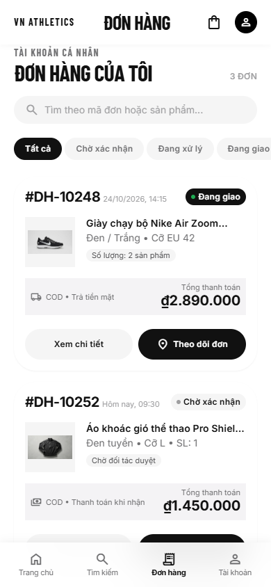
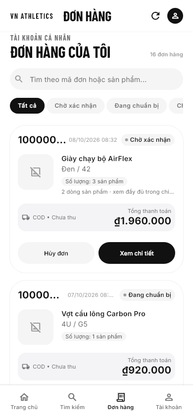

# MH07 — READY FOR USER VISUAL REVIEW

Ngày kiểm tra: 10/10/2026 (Asia/Saigon). Chưa được người dùng duyệt UI. Dừng tại MH07; không chuyển MH08, MH09, MH17 hoặc Phase 3.

## Phạm vi và nguồn

- Thiết kế: đọc toàn bộ `docs/ui_mocks/MH07_My_Orders.html`, CSS, Tailwind config, các component và script. HTML/ảnh đính kèm là nội dung tham chiếu, không cấp quyền thêm nghiệp vụ.
- Business/data: Technical Specification revision 1.2 và contracts hiện có.
- Workspace đã có nhiều thay đổi/untracked từ trước nhiệm vụ. Báo cáo chỉ liệt kê phần sửa trong lượt MH07; các thay đổi tồn tại của màn khác được giữ nguyên. Không reset, clean, checkout, đổi branch, commit, push hoặc xóa untracked.

## Sửa Preview và lifecycle

1. Nguyên nhân `No ProviderScope found`: scope cũ ở dưới `MaterialApp.home`, trong khi modal/dialog được gắn vào Navigator phía trên nó. Scope còn keyed theo screen/scenario nên có thể bị thay trong khi route còn sống.
2. Scope mới ổn định ở trên `MaterialApp`/Navigator. Repository/environment được giữ xuyên rebuild; đổi kịch bản invalidate session provider với generation mới, không dispose/reparent scope đang được modal sử dụng. Không suppression/try-catch che lỗi Flutter.
3. Dialog từ detail đọc root scope nhưng capability lấy từ cache riêng của sheet. Bổ sung `sourceCache` tùy chọn để dialog quan sát đúng invalidation; consumer khác vẫn dùng cache như trước.
4. Regression session expiry khi dialog còn mở phát hiện một lỗi thực tế: builder đọc `WidgetRef` của detail đã deactivated. Capture cache trước `showDialog`, kiểm tra `context.mounted` trong callback và sau await để không đọc ref đã unmount.
5. Outer Scaffold Preview không xử lý keyboard inset lần thứ hai; MH07 Scaffold sở hữu inset. Sửa overflow xảy ra khi bàn phím mở với text scale 2.

## UI MH07

- Header trắng cao 64, Barlow Condensed, brand và avatar; giữ refresh để thực hiện chức năng hiện có.
- Tiêu đề 32/36, caption thể thao, search pill, chips ngang với selected đen/unselected xám. Counts không thêm avatar vào chip. Giữ nguyên filter theo enum/semantics hiện có.
- Card trắng radius 32, padding 16, thumbnail placeholder 72×72, khoảng cách 16, status pill, khối COD nền xám, tổng tiền 20/26, hai action pill cao tối thiểu 44.
- Ngày/giờ từ server được format Hà Nội. ID thật là UUID; không tạo mã DH hoặc ảnh catalog giả làm snapshot.
- Detail sheet: close button, UUID đầy đủ, trạng thái, người mua/người nhận, sản phẩm, giá và phí/COD, timeline server, cancel/return theo capability và freshness như trước.
- Footer hỗ trợ theo hình thức mockup; liên hệ disabled khi chưa tích hợp. Bottom navigation cao 64 ở scale 1 (tăng theo accessibility), chỉ bật trong Preview, không sửa production router và không điều hướng đến màn khác.
- Cỡ chữ lớn chuyển header/card/payment/actions sang bố cục phù hợp, không khóa text scaling.

## Ảnh tham chiếu và so sánh

HTML đã được render thật bằng Chromium/Playwright từ file gốc, không chỉnh HTML. Viewport kiểm chứng: `innerWidth=390`, `innerHeight=844`, `scrollWidth=390`, fonts loaded. Thử local HTTP trong browser của app không thành công; lần CLI Chrome đầu có viewport thực tế khác nên đã thay bằng renderer đặt viewport chính xác.

| HTML 390×844 | Flutter 390×844, scale 1 |
| --- | --- |
|  |  |

- [HTML full page](ui_review_artifacts/mh07_html_390_full.png).
- [Flutter detail](ui_review_artifacts/mh07_flutter_390_s1_0_detail.png).
- [Flutter detail cuối](ui_review_artifacts/mh07_flutter_390_s1_0_detail_bottom.png).
- [Flutter cuối danh sách](ui_review_artifacts/mh07_flutter_390_s1_0_bottom.png).
- [SafeArea 320, scale 2](ui_review_artifacts/mh07_flutter_safe_area.png).
- [Keyboard 320, scale 2](ui_review_artifacts/mh07_flutter_keyboard.png).
- [Dialog hủy trên Pixel_5](ui_review_artifacts/mh07_android_cancel.png).

Đã kiểm tra và chỉnh các khác biệt lớn về header alignment, card spacing, timestamp, tổng tiền và vị trí actions. Không tuyên bố pixel-perfect.

### Sai khác còn lại

- UUID dài có ellipsis trên card, tooltip/detail chứa đầy đủ; HTML dùng mã ngắn `DH-*`. UUID route/search giữ nguyên. Test selector đổi sang text UUID đầy đủ, không xóa assertions quyền/nghiệp vụ.
- Placeholder thay ảnh snapshot vì contract chưa có ảnh lịch sử; không hardcode ảnh mock vào đơn production.
- Preview có 16 đơn và dữ liệu theo domain, khác 3 đơn của HTML. Đơn đầu nhiều sản phẩm nên card có thêm dòng tổng số dòng sản phẩm.
- Nhãn trạng thái theo contract (ví dụ “Đang chuẩn bị”, “Đã giao hàng”) và filter của toàn bộ enum; không thêm filter “Trả hàng” bằng cách nhập lifecycle return vào order.
- Header dùng refresh thay shopping bag vì MH07 có refresh và chưa có callback cart. Avatar là visual, không mở Auth/profile.
- Không có “Mua lại”. “Theo dõi đơn” mở thông tin/timeline, không GPS. Return creation/tracking và contact chưa có callback tích hợp nên disabled. Không cam kết hỗ trợ 24/7 từ câu copy demo.
- Header/search/filter vẫn là vùng cố định của màn; HTML scroll cả phần nội dung bên dưới header. Bottom navigation là hình thức Preview, các tab không điều hướng.
- HTML không có detail modal; detail được thiết kế từ cùng typography/colors/radius, không có screenshot modal gốc để đối chiếu.
- Font/icon rasterization Flutter và Chromium khác nhau; status/data, ID dài và accessibility reflow tạo chiều cao khác.

## Chạy Preview trên Android

Chạy từ project root bằng PowerShell. Nếu Pixel_5 chưa chạy:

```powershell
flutter emulators --launch Pixel_5
flutter devices
```

Lệnh đã build/cài/chạy trên `emulator-5554`, Android 15/API 35:

```powershell
$env:GRADLE_OPTS='-Dorg.gradle.project.kotlin.incremental=false -Dorg.gradle.project.kotlin.compiler.execution.strategy=in-process'
flutter run --no-pub -d emulator-5554 -t tool/ui_preview/main.dart
```

Hai Gradle properties là workaround trong process trên máy này: Kotlin incremental caches của `url_launcher_android`/`shared_preferences_android` lỗi khi plugin cache và project ở các ổ khác nhau. Không chỉnh Gradle project hoặc xóa cache. Lần chạy với workaround build/cài thành công, hot reload thành công. Thay device ID nếu `flutter devices` trả ID khác.

Để ẩn toolbar demo và quan sát bố cục sát screenshot:

```powershell
flutter run --no-pub -d emulator-5554 -t tool/ui_preview/main.dart --dart-define=MH07_HIDE_CONTROLS=true
```

Entry point debug không khởi tạo Supabase/Auth. Demo được ghi rõ trong toolbar, chỉ nằm ở `tool/ui_preview`/test DI. Chế độ ẩn toolbar vẫn là demo.

## Checklist review tay

1. Giữ màn MH07 mặc định. Tìm `AirFlex`, thử UUID đầy đủ hoặc tên sản phẩm; thử từ khóa không có kết quả, clear search.
2. Chọn “Chờ xác nhận”, cuộn ngang chips đến đang giao/đã giao/đã hủy, chọn lại “Tất cả”. Cuộn dọc qua các trang (4 đơn/trang) đến footer; refresh.
3. Mở “Xem chi tiết” nhiều lần, đóng bằng X/drag/back. Với đơn nhiều sản phẩm, cuộn xem đủ items, recipient, payment và timeline.
4. Mở “Hủy đơn” từ card pending; mở hủy trong detail. “Tiếp tục” hiện API chưa khả dụng theo baseline Phase 2, không báo success, không gửi mutation production. Demo repository có unit test cancellation in-memory nhưng UI dialog không tự gọi mutation đó.
5. Menu “Chọn trạng thái” bên phải toolbar: `data`, `loading`, `empty`, `error`, `stale`, `expired`. `loading` chờ 4 giây rồi nhận data; `stale` refresh lần sau lỗi. Quay lại `data` để khôi phục session mới.
6. Quan sát keyboard/search, safe insets, portrait; thay font size Android để review readability. Không dùng menu chọn màn để chuyển sang màn khác trong lần duyệt MH07.
7. Gửi feedback MH07 về typography, spacing, card và modal. UI chỉ được chấp thuận khi người dùng xác nhận trực tiếp.

## Kiểm chứng và giới hạn

- Baseline focused MH07 trước UI: 16 tests PASS.
- Focused MH07 + lifecycle/visual: 19 tests PASS sau thay đổi UUID/header; preview dataset/filter/pagination/cancellation: 3 tests PASS.
- Ma trận widget: 320/360/390/412 × scale 1/1.5/2, screenshot top/scroll/cuối danh sách/detail/detail cuối; 320 scale 2 keyboard và SafeArea. Không exception/overflow.
- Actual tree Preview: mount/unmount 3 lần × mở/đóng detail 3 lần; dialog detail invalidation → expired với dialog còn sống, fail closed, không deactivated ref/disposed-container exception.
- Android: build/cài/chạy Pixel_5, mở/đóng detail, mở/đóng dialog hủy, bấm tiếp tục nhận unavailable, scroll danh sách; hot reload. Không quan sát ProviderScope/_dependents exception trong các thao tác này.
- Android chưa chạy toàn bộ ma trận device/text-scale hoặc tất cả kịch bản bằng automation; ma trận và session-expiry lồng được kiểm chứng bằng widget tests. Screenshot so sánh 390px là Flutter widget renderer, ảnh Android dialog riêng có khung emulator. Không coi fixture test là xác minh backend thật.
- Production Auth/router/backend không sửa, không kiểm chứng kết nối backend và không áp dụng migration.
- Kết quả final trên source cuối: `dart format` 11 file, 0 thay đổi; `flutter analyze --no-pub` **No issues found**; `flutter test --no-pub` **186 tests PASS**; `git diff --check` exit 0, chỉ có cảnh báo LF/CRLF cho working copy. Log: `.ui_review_tmp/mh07_final_analyze.log`, `mh07_final_tests.log`, `mh07_final_diff_check.log`.
- Renderer cuối: `.ui_review_tmp/mh07_final_visual.log`, **3 tests PASS**, 62 ảnh Flutter (12 tổ hợp × 5 góc nhìn + keyboard/SafeArea). Full suite cuối 186 PASS bao gồm baseline 182 tests và 4 tests mới; không bỏ business assertions.
- Review độc lập GPT-5.6 Sol/Medium xác nhận guards/lifecycle; worker GPT-5.6 Luna/Max phụ trách Preview/fixture. Giữ padding mặc định OrderFeed 20 từ dirty state trước nhiệm vụ, không revert về giá trị committed cũ và không thay UI manager.

## Files sửa/tạo trong nhiệm vụ

- `lib/features/orders/presentation/pages/customer_orders_page.dart`
- `lib/features/orders/presentation/widgets/mh07_order_card.dart` (mới, chỉ MH07)
- `lib/features/orders/presentation/widgets/order_feed.dart` (optional builder/padding/footer, giữ default trước nhiệm vụ)
- `lib/features/orders/presentation/widgets/order_action_dialog.dart` (optional decision cache)
- `tool/ui_preview/main.dart`
- `tool/ui_preview/preview_app.dart`
- `tool/ui_preview/mh07_preview_data.dart` (mới)
- `tool/ui_preview/render_mh07_reference.cjs` (mới)
- `test/visual_refinement/preview_app_test.dart`
- `test/visual_refinement/mh07_visual_review_test.dart` (mới)
- `test/visual_refinement/visual_layout_test.dart` (selector UUID chỉ nhánh MH07)
- `test/features/orders/presentation/pages/customer_orders_page_test.dart` (selector UUID; giữ business assertions)
- `docs/ui_review_mh07.md` (mới), ảnh `docs/ui_review_artifacts/mh07_html_*`, `mh07_flutter_*`, `mh07_android_cancel.png`; log `.ui_review_tmp/mh07_*`.

Không sửa `pubspec.yaml`/lockfile, central router, backend hoặc UI MH08/MH09/MH17 trong nhiệm vụ này. Các file đó có thể xuất hiện trong `git status` vì dirty state có từ trước.

**MH07 — READY FOR USER VISUAL REVIEW**

## Commit riêng MH07

Theo yêu cầu tiếp theo của người dùng, lưu commit riêng MH07. Entry point `tool/ui_preview/main.dart` dùng harness `tool/ui_preview/mh07_preview_app.dart` chỉ có MH07; harness nhiều màn trước đó vẫn nằm ngoài commit. Các thay đổi MH08/MH09/MH17 và refinement shared có trước nhiệm vụ được giữ ngoài commit.

Kiểm chứng sau khi tách commit: working tree đạt `flutter analyze --no-pub` và 186 tests. Snapshot index riêng được xuất để kiểm tra; analyze toàn snapshot báo thiếu `notification_interaction_view_model.dart` mà HEAD đã tham chiếu từ MH17 nhưng file vẫn chưa được commit. Đây là phụ thuộc có trước MH07, được giữ ngoài commit đúng phạm vi. Không tuyên bố toàn repository ở trạng thái commit độc lập đã analyze PASS.
Focused tests trên snapshot MH07: 19/19 PASS, gồm matrix viewport/text scaling, keyboard/SafeArea và regression lifecycle modal.
